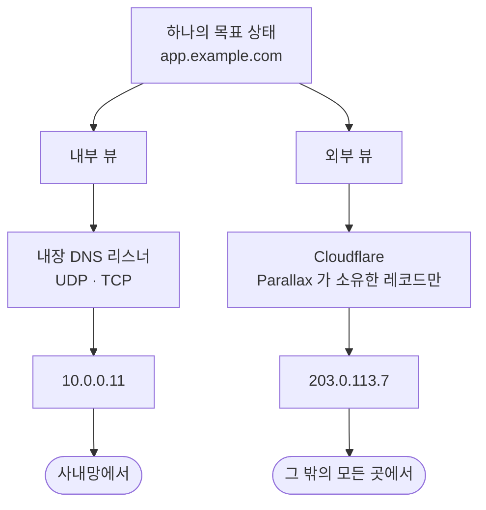
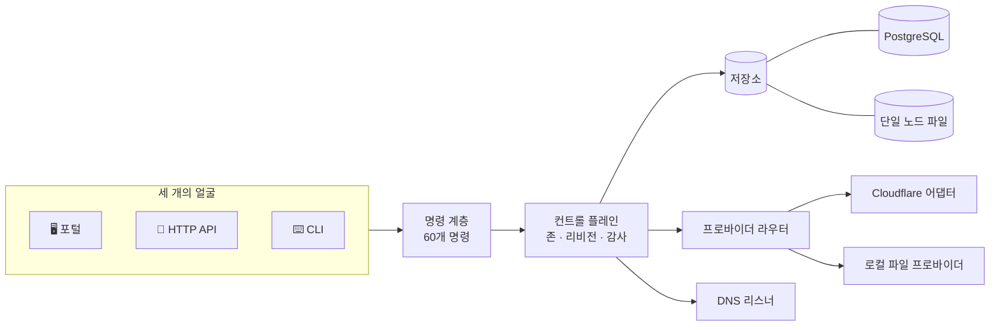
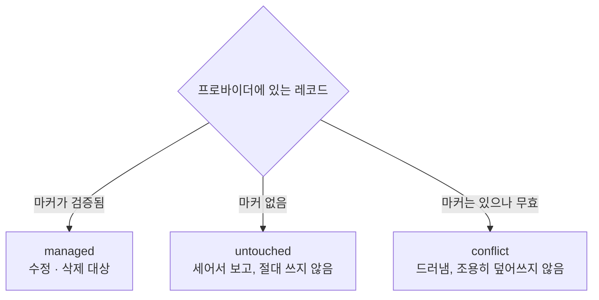

<div align="center">

<h1>parallax</h1>

### **split-horizon DNS 컨트롤 플레인이자 운영 포털.**

내부 DNS와 외부 프로바이더 DNS의 목표 상태를 한곳에 두고, 바뀌기 전에 미리
보여 주며, 자기가 소유한 레코드에만 적용합니다.

<br/>

[](https://github.com/henryj-dev/parallax/actions/workflows/check.yml)
[](https://github.com/henryj-dev/parallax/actions/workflows/codeql.yml)

<br/>


[](#http-api)
[](LICENSE)

<br/>

> *시차(parallax)는 같은 것을 다른 자리에서 볼 때 위치가 달라 보이는 현상입니다 —
> 하나의 대상, 두 개의 답, 그리고 둘 다 옳습니다.*

[English](README.md) · 한국어

</div>

---

## 목차

- [문제](#문제)
- [무엇을 하는가](#무엇을-하는가)
- [빠른 시작](#빠른-시작)
- [구조](#구조)
- [소유권 모델](#소유권-모델)
- [설정](#설정)
- [명령줄](#명령줄)
- [HTTP API](#http-api)
- [레코드 타입](#레코드-타입)
- [포털](#포털)
- [운영](#운영)
- [개발](#개발)
- [현재 상태와 한계](#현재-상태와-한계)
- [라이선스](#라이선스)

---

## 문제

같은 이름이 누가 묻느냐에 따라 다른 것을 가리켜야 합니다. 그걸 두 시스템에
나눠 두면, 맞게 유지하는 일도 두 번 해야 합니다.



Parallax는 목표 상태를 **하나만** 두고, 그것을 **두 뷰**로 투영한 뒤, 각 뷰를
실제 상태와 맞춥니다 — 계획을 먼저 보여 준 다음에.

---

## 무엇을 하는가

<table>
<tr>
<td width="50%" valign="top">

### 🎯 하나의 상태, 두 개의 뷰
레코드는 한 번만 존재합니다. `internal`과 `external`은 그것의 투영이고, 모든
프로바이더 대상은 `<zone>/<view>`로 지정됩니다.

</td>
<td width="50%" valign="top">

### 🛡️ 자기 것만 건드림
발행하는 모든 레코드에 **HMAC 서명된 소유권 마커**가 붙습니다. 자기가 쓰지
않은 레코드는 세어서 보고할 뿐, 손대지 않습니다.

</td>
</tr>
<tr>
<td valign="top">

### 👁️ 적용 전에 미리보기
`preview`가 계획을 만듭니다 — 생성·수정·삭제·충돌, 그리고 **건드리지 않을**
레코드의 수까지. 「할 일이 없다」와 「거기에 아무것도 없다」를 결코 혼동할 수
없게 하기 위해서입니다.

</td>
<td valign="top">

### 📡 DNS를 직접 응답
내부 뷰를 UDP와 TCP로 직접 응답하는 권한 리스너입니다. EDNS(0), DNS 쿠키,
AXFR(기본 거부), 아웃바운드 NOTIFY, 허용 목록 기반 포워딩, 클라이언트별
레이트 리밋을 갖췄습니다. 켜면 헬스체크가 실패하는 주소를 내부 A·AAAA 답에서
뺍니다.

</td>
</tr>
<tr>
<td valign="top">

### ⏪ 모든 변경이 리비전
번호가 매겨진 리비전, 스냅샷 복원, 그리고 각 리비전이 레코드를 몇 개
더하고 빼고 바꿨는지까지 보고하는 10종 감사 기록.

</td>
<td valign="top">

### 🤝 빼앗지 않고 인수
`zone adopt`는 프로바이더에 이미 있는 것을 *설명할* 뿐입니다. 넘겨받는 것은
별도의 명시적 결정입니다.

</td>
</tr>
<tr>
<td valign="top">

### 🔐 역할·토큰·SSO
`viewer` · `editor` · `admin`. 발급형 액세스 토큰, 또는 프로토콜에 직접
맞춰 구현한 OpenID Connect 로그인.

</td>
<td valign="top">

### 🧭 하나의 머리, 세 개의 얼굴
포털·HTTP API·CLI가 **같은 명령 계층**을 호출합니다 — 그래서 서로 갈라질 수가
없습니다.

</td>
</tr>
</table>

---

## 빠른 시작

```bash
git clone https://github.com/henryj-dev/parallax
cd parallax
corepack enable
pnpm install --frozen-lockfile
```

**실행합니다.** 아무것도 설정하지 않으면 루프백에 바인드하고 상태를 파일에
둡니다 — 데이터베이스도, 토큰도, 준비 과정도 필요 없습니다:

```bash
pnpm dev                       # http://127.0.0.1:3000
```

**또는 명령줄로 다룹니다.** CLI는 저장소에 직접 닿습니다. 레코드 본문은 JSON 한 값으로
넘기며, HTTP API가 받는 것과 같은 모양입니다:

```bash
pnpm cli settings set --values '{"allowLocalProvider":true}'   # 우선 파일에 게시

pnpm cli zone create --zone example.com
pnpm cli record set --zone example.com --view internal --id app \
        --record '{"name":"app","type":"A","content":"10.0.0.11","ttl":300}'
pnpm cli record set --zone example.com --view external --id app \
        --record '{"name":"app","type":"A","content":"203.0.113.7","ttl":300,"acknowledgeNonGlobalIp":true}'

pnpm cli preview --zone example.com     # 무엇이 바뀌는지
pnpm cli apply   --zone example.com     # 반영
pnpm cli status  --zone example.com     # 각 뷰가 어디까지 적용됐는지
```

저 중 두 줄은 가드가 방해하는 것이 아니라 제대로 동작하는 모습입니다.
`allowLocalProvider`는 기본이 꺼져 있어서, 그 줄이 없으면 `apply`가 각 뷰를
`no provider is configured`와 함께 `failed`로 보고합니다 — Cloudflare 크리덴셜이 생기기
전까지 게시할 곳이 없고, 그동안은 파일이 그 자리를 대신합니다. `203.0.113.7`은 문서용
주소라 전역으로 라우팅되지 않으므로, 노출을 검토했다고 말할 때까지 외부 뷰가 거부합니다.
두 거부가 바로 요점입니다. 실제 배포는 실제 프로바이더에 실제 주소를 쓰므로 두 줄 다
필요하지 않습니다.

> [!IMPORTANT]
> Parallax는 **액세스 토큰 없이 루프백이 아닌 주소로는 기동을 거부합니다.**
> 루프백 세션에서 토큰을 발급하거나 `PARALLAX_AUTH_TOKENS`를 설정하십시오.
> 경고가 아니라 기동 검사입니다.

---

## 구조



들어가는 길은 명령 계층뿐입니다. HTTP API는 그 위의 얇은 사상이고 — OpenAPI
문서의 각 오퍼레이션이 자기가 닿는 명령의 이름을 답니다 — CLI는 전권으로
동작합니다. 그 박스의 셸을 쥐었다는 것이 곧 컨트롤 플레인 접근이기 때문입니다.

<details>
<summary><b>소스 트리</b></summary>

| 디렉터리 | 무엇이 있는가 |
|---|---|
| `src/domain/` | 레코드 타입, 검증, 조정 계획 수립, 존 파일 |
| `src/application/` | 컨트롤 플레인, 설정, 액세스 토큰, 자격 증명, fallback 도메인 |
| `src/adapters/` | Cloudflare, 소유권 마커, 프로바이더 라우터 |
| `src/dns/` | 와이어 포맷, RDATA, 쿠키, 권한 리스너, 스냅샷 |
| `src/http/` | API, 신원 라우트, OpenAPI 생성, readiness, 포털 자산 |
| `src/infrastructure/` | PostgreSQL, 파일 상태, 원자적 쓰기, 마이그레이션 |
| `src/security/` | 인가, OIDC, 세션 토큰, 암호화된 자격 증명 저장소 |
| `src/observability/` | Prometheus 메트릭과 시그널 |
| `public/` | 포털 — 바닐라 JS, 번들러 없음 |
| `cmd/parallax/` | 명령줄 진입점 |

</details>

---

## 소유권 모델

Parallax가 사람·Terraform·인증서 봇과 한 존을 나눠 쓰면서도 서로 밟지 않게
해 주는 부분입니다.

발행하는 모든 레코드는 프로바이더의 자유 텍스트 필드에 마커를 답니다 —
Cloudflare의 레코드 코멘트, 존 파일의 후행 코멘트:

```text
parallax-managed:v3:<record-id>:<hmac-signature>
```



서명은 레코드 id뿐 아니라 **대상**까지 덮으므로, 마커를 다른 존에 복사하면
거기서는 검증되지 않습니다. 마커가 대상 자체를 담지 *않는* 것은 의도적입니다.
Cloudflare 코멘트는 100자로 제한되는데, 호출자가 이미 아는 값에 그 예산을
쓰다가 이름이 긴 존에서는 모든 쓰기가 실패한 적이 있습니다.

> [!NOTE]
> `PARALLAX_OWNERSHIP_SECRET`을 교체하면 이미 발행된 모든 레코드가 고아가
> 됩니다 — 검증되지 않게 되어 *untouched*로 분류됩니다.

---

## 설정

루프백에서 파일 상태로 띄우는 데는 아래 중 아무것도 필요하지 않습니다.

<details open>
<summary><b>기본</b></summary>

| 변수 | |
|---|---|
| `HOST` · `PORT` | API와 포털이 바인드하는 곳. 기본값 `127.0.0.1:3000` |
| `DATABASE_URL` | PostgreSQL 사용. 없으면 단일 노드 파일 |
| `PARALLAX_STATE_FILE` · `PARALLAX_CONFIG_FILE` · `PARALLAX_PROVIDER_STATE_FILE` | 그 파일들의 위치. 상태 파일은 히스토리를 옆의 `<상태 파일>.d/` 에 둔다 — 백업은 파일 하나가 아니라 디렉터리 단위로 |
| `PARALLAX_AUTH_TOKENS` | 비상용 토큰(JSON). 평소 토큰은 포털에서 발급 |
| `PARALLAX_AUTH_MODE` | `legacy`(없을 때의 기본값) 또는 `accounts`. `accounts`는 자기 정책 파일·키·SMTP 설정이 있어야 하고, 없으면 시작을 거절한다. 그 밖의 값은 설정 오류다. [회원 계정](#회원-계정) 참고 |
| `PARALLAX_OWNERSHIP_SECRET` | 소유권 마커 서명 |
| `PARALLAX_CREDENTIAL_MASTER_KEY` | 저장된 프로바이더 자격 증명 암호화(AES-256-GCM) |

</details>

<details>
<summary><b>TLS와 신원</b></summary>

| 변수 | |
|---|---|
| `PARALLAX_TLS_CERT_FILE` · `PARALLAX_TLS_KEY_FILE` | 프록시 뒤가 아니라 프로세스가 직접 TLS 종단. 변경되면 재적재 |
| `PARALLAX_HTTP_REDIRECT_PORT` | 평문 HTTP를 TLS origin으로 리다이렉트 |
| `PARALLAX_OIDC_ISSUER` · `_CLIENT_ID` · `_CLIENT_SECRET` · `_REDIRECT_URI` · `_SCOPES` | OpenID Connect 로그인. 엔드포인트는 발급자의 `/.well-known/openid-configuration` 에서 읽는다. 그것을 내놓지 않는 프로바이더는 `{issuer}/oidc/…` 로 되돌아가고 로그인 때 그렇게 말한다 |
| `PARALLAX_OIDC_ROLE_CLAIM` | 여기서의 역할(`admin`·`editor`·`viewer`)을 담은 userinfo 클레임. 기본값 `entitlements` — 표준 클레임이 없으므로 다르게 부르는 디렉터리는 이름을 대야 한다 |
| `PARALLAX_OIDC_SESSION_SECRET` · `_SESSION_SECONDS` | 세션 서명과 수명 |
| `PARALLAX_PORTAL_SIGN_IN` | 로그인하지 않은 방문자에게 포털이 무엇을 제시할지 |

</details>

<details>
<summary><b>DNS 리스너</b></summary>

`PARALLAX_DNS_PORT`를 설정하는 것이 리스너를 켜는 스위치입니다. 나머지는 모두
기본값이 있고, 그 기본값은 조심스러운 쪽입니다.

| 변수 | |
|---|---|
| `PARALLAX_DNS_PORT` | **리스너를 켭니다.** 설정하지 않으면 포트를 열지 않음 |
| `PARALLAX_DNS_HOST` | 기본값은 `HOST`, 그다음 `127.0.0.1` |
| `PARALLAX_DNS_FORWARD_TO` | 모든 존 밖 이름의 상위. 비우면 `REFUSED`로 답함 |
| `PARALLAX_DNS_FORWARD_ALLOW` | 재귀를 허용할 클라이언트 CIDR. 기본은 루프백이고, 리스너가 루프백이 아니면서 포워딩이 켜져 있으면 **필수** |
| `PARALLAX_DNS_FALLBACK_ZONES` | 빈 답(NXDOMAIN, NODATA)을 내기 전에 상위에 먼저 물어볼 존. 비우면 꺼짐. 내부 override가 있는 이름, `FORWARD_ALLOW` 밖 클라이언트, 서명된 질의, `FALLBACK_EXCLUDE` 아래 이름은 절대 묻지 않는다. 상위가 실패하면 로컬 답을 준다. 상위의 부정 TTL은 로컬 값으로 상한을 둔다 |
| `PARALLAX_DNS_FALLBACK_EXCLUDE` | 그 이름과 아래 전부를 폴백하지 않는다 — 내부에만 있는 하위 트리. 각 항목은 폴백 존 안이어야 함 |
| `PARALLAX_DNS_FORWARD_DENY` | 상위가 되거나 그 주소로 풀려서는 안 되는 주소: 여기로 되돌려 보내는 리졸버(게이트웨이, 클러스터 DNS, 이 리스너의 서비스 주소). `FALLBACK_ZONES`와 함께 **필수** |
| `PARALLAX_DNS_DRIFT_INTERVAL_MS` | 프로바이더엔 있는데 서빙 존의 내부 뷰가 답하지 않는 레코드를 세는 주기(`parallax_dns_provider_only_records`, 이름은 로그로). 기본 900000, `0`이면 끔 |
| `PARALLAX_DNS_TRANSFER_ALLOW` | `AXFR`·`IXFR`를 허용할 클라이언트 CIDR. **기본은 전부 거부** |
| `PARALLAX_DNS_TSIG_KEYS` | `name:algorithm:base64secret`, 쉼표 구분. 키를 하나라도 두면 `AXFR`에 유효한 TSIG 서명이 **필수**가 된다. `hmac-sha256`/`hmac-sha512`만 |
| `PARALLAX_DNS_NOTIFY_TO` | 서빙 중인 존의 serial이 오를 때 NOTIFY를 받을 호스트. `host`, `host:port`, 또는 서명할 키를 지정하는 `host:port#keyname` |
| `PARALLAX_DNS_INTERNAL_UPDATE` | `host:port#keyname` — internal 뷰를 **RFC 2136** 서버에도 발행한다. 발행받은 서버는 이 프로세스가 멈춰도 계속 답하고, 이 프로세스 안의 리스너는 그러지 못한다 |
| `PARALLAX_DNS_SOA_PRIMARY` · `_SOA_MAILBOX` | SOA 필드 |
| `PARALLAX_DNS_REQUIRE_COOKIE` | RFC 7873 DNS 쿠키 요구 |
| `PARALLAX_DNS_RATE_LIMIT_PER_SECOND` · `_BURST` · `_MAX_CLIENTS` | 클라이언트별 레이트 리밋 |
| `PARALLAX_DNS_MAX_TCP_CONNECTIONS` · `_MAX_CONCURRENT_FORWARDS` · `_FORWARD_TIMEOUT_MS` | 자원 상한 |

</details>

<details>
<summary><b>저장된 설정</b> — 환경변수가 아니라 저장소에 있습니다</summary>

| 설정 | |
|---|---|
| `allowLocalProvider` | 대상에 실제 프로바이더가 없을 때 로컬 파일로 발행 |
| `publicOrigin` | 브라우저가 포털에 닿는 절대 origin. 비우면 요청마다 유도 |
| `trustForwardedHeaders` | `X-Forwarded-Proto` / `X-Forwarded-Host` 신뢰, 그리고 회원 시도 제한이 세는 클라이언트 주소로 `X-Forwarded-For` 사용 |
| `revisionRetention` | 존마다 보관할 최신 스냅샷 수. `0`이면 전부 보관 |
| `auditRetentionDays` | 존마다 보관할 감사 이력 일수. `0`이면 전부 보관 |
| `fallbackResolver` | 클라이언트 측 리졸버 오버라이드가 가리킬 주소 |
| `dnsHealthChecksEnabled` | 내부 헬스체크가 보호하는 주소를 프로브. 기본값 `false` |
| `dnsHealthCheckAllowCidrs` | 프로브가 접속해도 되는 네트워크. 기본값은 빈 목록이고, 아무 데도 허용하지 않음 |
| `dnsHealthCheckAllowPorts` | 프로브가 접속해도 되는 포트. 기본값은 빈 목록이고, 아무 포트도 허용하지 않음 |

</details>

---

## 명령줄

60개 명령. 어느 것에든 `--json`을 붙이면 기계가 읽는 출력이 나오고,
`parallax help <command>`로 옵션을 봅니다.

<details open>
<summary><b>존과 레코드</b></summary>

| 명령 | |
|---|---|
| `zone list` · `zone get` · `zone create` · `zone delete` | 기본 |
| `zone replace` | 존의 목표 상태 전체를 교체 |
| `zone adopt` | 프로바이더에 이미 있는 것을 넘겨받지 않고 설명 |
| `zone export` · `zone import` | 뷰 단위 presentation-format 존 파일 |
| `record list` · `get` · `set` · `create` · `patch` · `delete` | 레코드 하나씩 |
| `record batch` | 삭제·패치·put·post를 **하나의 리비전**으로 |

</details>

<details>
<summary><b>조정</b></summary>

| 명령 | |
|---|---|
| `preview` | 목표와 실제를 비교하고 아무것도 바꾸지 않음 |
| `apply` | 한 존의 프로바이더를 맞춤 |
| `apply pending` | 대기 중인 모든 존에 적용, `--retryFailed`로 실패분 재시도 |
| `status` | 각 뷰가 어디까지 적용됐는지 |

</details>

<details>
<summary><b>이력</b></summary>

| 명령 | |
|---|---|
| `history` | 감사 기록, 최신 순 |
| `revision list` · `revision get` | 저장된 스냅샷 |
| `revision restore` | 스냅샷을 **새 리비전으로** 복원 |

</details>

<details>
<summary><b>자격 증명과 접근</b></summary>

| 명령 | |
|---|---|
| `credential profile list` · `get` · `set` · `delete` · `test` | 재사용 가능한 계정 자격 증명 |
| `credential zone list` · `get` · `set` · `delete` · `test` | apex 도메인을 프로필·존 id에 바인딩 |
| `token list` · `token issue` · `token revoke` | 액세스 토큰 — 발급된 토큰은 딱 한 번만 반환됨 |
| `settings get` · `settings set` | 저장된 운영 설정 |

</details>

<details>
<summary><b>클라이언트 측 리졸버 오버라이드</b></summary>

Cloudflare의 로컬 도메인 fallback 목록을, 프로필이 이미 쥔 자격 증명으로
다룹니다 — 두 번째 토큰을 입력하는 사람은 없습니다.

| 명령 | |
|---|---|
| `fallback list` | 오버라이드 목록 |
| `fallback coverage` | 여기 있는 모든 존에 대해: 덮이는가, 아니라면 왜 아닌가 |
| `fallback preview` · `fallback sync` | 이 프로필의 존들과 맞추면 무엇이 바뀌는지 보고, 맞춤 |
| `fallback set` · `fallback delete` | 접미사 하나씩 |

</details>

<details>
<summary><b>내부 헬스체크</b></summary>

| 명령 | |
|---|---|
| `health check list` | 존의 내부 뷰에 걸린 정책 |
| `health check set` · `health check delete` | 내부 A·AAAA RRset 하나당 정책 하나, 각각 새 리비전 |
| `health check status` | 정책마다 **이 프로세스가** 각 주소를 어떻게 판정하는지 |

```bash
pnpm cli health check set --zone example.com \
  --policy '{"name":"app","type":"A","enabled":true,"probe":{"kind":"tcp","port":443}}'
pnpm cli health check set --zone example.com --whenNoneHealthy answer-all \
  --policy '{"name":"app","type":"A","enabled":true,"probe":{"kind":"https","port":8443,"path":"/readyz"}}'
pnpm cli health check status --zone example.com
```

</details>

<details>
<summary><b>운영</b></summary>

| 명령 | |
|---|---|
| `config check` | 이 프로세스의 기동을 막을 것을 **기동하지 않고** 보고 |
| `migrate` | 데이터베이스 스키마 적용, 재실행해도 안전 |
| `backup` | 이 저장소가 가진 전부를 문서 하나로 내보낸다 |
| `restore` | 그 문서를 **빈** 저장소로 읽어 들인다. 백엔드는 어느 쪽이든 |
| `openapi` | 이 컨트롤 플레인 자신의 OpenAPI 기술을 출력 |

</details>

<details>
<summary><b>회원 계정 (호스트 전용)</b></summary>

| 명령 | |
|---|---|
| `accounts enable` · `accounts status` · `accounts list` | 회원 계정을 켜고 상태를 본다 |
| `accounts bootstrap` | 첫 관리자. 비밀번호는 stdin으로 |
| `accounts recover` · `accounts mfa reset` | 잃어버린 2단계 인증수단 교체 |
| `accounts legacy` | 기존 조직 로그인을 위한 정해진 기간 |

어느 것도 HTTP로는 닿지 않는다. [회원 계정](#회원-계정) 참고.

</details>

`backup` 과 `restore` 에는 HTTP 경로가 없고 생길 수도 없다 — 서빙 런타임에는 이
둘이 쓰는 리포지터리 자체가 주어지지 않는다. 백엔드 사이를 옮기는 방법이기도
하다. 두 저장소가 같은 인터페이스를 구현하고, 문서는 그 인터페이스만 말한다:

```bash
PARALLAX_STATE_FILE=./data/state.json parallax backup --json > parallax-backup.json
DATABASE_URL=postgres://… parallax migrate
DATABASE_URL=postgres://… parallax restore < parallax-backup.json
```

⚠️ 이 문서는 **상태 파일만큼 민감하다** — 상태 파일의 사본이기 때문이다. 자격증명
저장소의 암호문이 그대로 들어간다. `PARALLAX_CREDENTIAL_MASTER_KEY` 없이는 쓸모가
없지만, 그렇다고 상태 파일을 두지 않을 곳에 둬도 되는 것은 아니다. `restore` 는 존
이나 토큰이 이미 있는 저장소를 거부한다 — 병합이 아니다. 감사 id 는 저장소가
매기므로 복원된 로그는 1부터 다시 매겨진다. 순서와 내용은 그대로다.

---

## HTTP API

**67개 경로.** 프로세스가 자기 명령 표에서 생성하는 OpenAPI 3.1 문서가
기술합니다 — 그래서 기술과 동작이 갈라질 수 없습니다.

```http
GET /api/v1/openapi.json
```

<details>
<summary><b>전체 라우트</b></summary>

| | |
|---|---|
| **존** | `GET POST /zones` · `GET PUT DELETE /zones/{zone}` |
| **레코드** | `GET /zones/{zone}/records`<br/>`GET POST /zones/{zone}/views/{view}/records`<br/>`GET PUT PATCH DELETE …/records/{id}`<br/>`POST …/records/batch` |
| **조정** | `GET POST /zones/{zone}/preview` · `POST /zones/{zone}/apply` · `POST /apply` · `POST /zones/{zone}/adopt` |
| **상태** | `GET /status` · `GET /zones/{zone}/status` · `GET /zones/{zone}/export` · `POST /zones/{zone}/import` |
| **이력** | `GET /history` · `GET /zones/{zone}/history` · `GET /zones/{zone}/audit`<br/>`GET /zones/{zone}/revisions` · `GET …/revisions/{revision}` · `POST …/restore` |
| **관리** | `GET PUT /settings` · `GET POST /tokens` · `DELETE /tokens/{id}` |
| **자격 증명** | `GET /credentials/profiles` · `GET PUT DELETE /credentials/profiles/{name}` · `POST …/test`<br/>`GET /credentials/cloudflare` · `GET PUT DELETE /credentials/cloudflare/{zone}` · `POST …/test` |
| **Fallback** | `GET /fallback/{profile}` · `…/coverage` · `…/preview` · `POST …/sync` · `PUT DELETE …/domains/{suffix}` |
| **헬스체크** | `GET /zones/{zone}/views/internal/health-checks` · `PUT DELETE …/health-checks/{name}/{type}`<br/>`GET /zones/{zone}/health-check-status` |
| **메타** | `POST /cli` · `GET /openapi.json` · `POST DELETE /session` |
| **프로브** | `GET /health/live` · `GET /health/ready` · `GET /metrics` |

</details>

**역할.** `viewer`는 읽고, `editor`는 레코드를 바꾸고, `admin`은 전부 합니다 —
자격 증명·설정·토큰은 **읽기까지 admin 전용**입니다. 각각이 누가 무엇을 할 수
있는지를 드러내거나 바꾸기 때문입니다.

**낙관적 동시성.** 변경 오퍼레이션은 `expectedRevision`을 받고, 존이 그 사이
움직였으면 거부합니다.

---

## 레코드 타입

23종. presentation format의 RDATA로 검증합니다 — 존 파일이 타입 뒤에 적는 바로
그 텍스트입니다:

```text
A · AAAA · CAA · CERT · CNAME · DNAME · DNSKEY · DS · HINFO · HTTPS · LOC · MX
NAPTR · NS · OPENPGPKEY · PTR · SMIMEA · SRV · SSHFP · SVCB · TLSA · TXT · URI
```

`SOA`는 제외했고, 서명자가 자기가 서명하는 존에 대해 만들어 내는 DNSSEC
레코드 — `RRSIG`, `NSEC`, `NSEC3` — 도 제외했습니다. 모든 프로바이더가 그것들을
스스로 만들고, 우리 것을 발행하면 묻지도 않은 답을 덮어쓰게 됩니다. `DS`와
`DNSKEY`는 **넣었습니다**. `DS`는 부모에 놓여 서명된 자식으로 위임하는 것이고,
그것은 남의 존에 대한 운영자의 결정이기 때문입니다.

> [!WARNING]
> **외부** 뷰에 비공개 주소를 발행하려면 해당 레코드에 `acknowledgeNonGlobalIp`를
> 설정해야 합니다. 그러지 않으면 거부됩니다 — `10.0.0.11`을 공개 인터넷에 올리는
> 것은 대개 실수이고, 실수가 아닐 때는 누군가 일부러 한 것이어야 합니다.

---

---

## 포털

같은 프로세스가 **한국어와 영어로** 서빙합니다. 빌드 단계는 없습니다.

- **Horizon 렌즈** — 레코드 하나, 두 개의 답을 나란히
- **존 작업 공간** — 레코드, 뷰별 동기화 상태, 리비전 진행
- **적용 계획 대화상자** — 계획을 검토하고 거기서 바로 적용
- **리비전 이력** — 스냅샷을 훑고 하나를 복원
- **자격 증명 설정** — 프로필, 존 바인딩, 리졸버 오버라이드, 토큰
- **로그인** — 액세스 토큰 또는 신원 공급자

---

## 운영

### 관측

| 엔드포인트 | |
|---|---|
| `GET /health/live` | 프로세스가 살아 있음 |
| `GET /health/ready` | 올바르게 답할 수 있음 — 목표 상태가 낡으면 fail closed |
| `GET /metrics` | Prometheus 텍스트 포맷 |

게이지는 선언 시점에 레지스트리로 복사하지 않고, 값을 이미 쥔 쪽에서 스크레이프
시점에 읽습니다. 복사본이 낡는 경로를 만들지 않기 위해서입니다.

```text
parallax_ready                                  readiness 를 통과할 상태면 1
parallax_desired_state_age_seconds              목표 상태를 마지막으로 읽은 뒤 경과
parallax_desired_state_max_age_seconds          readiness 가 실패하기까지 허용되는 낡음
parallax_dns_served_zones                       리스너가 답하는 존의 수
parallax_dns_health_healthy_targets             이 프로세스가 내주는 보호 주소
parallax_dns_health_unhealthy_targets           프로브가 실패해 뺀 보호 주소
parallax_dns_health_unknown_targets             최신 결과가 없는 보호 주소
parallax_access_token_cache_ready               캐시된 토큰으로 인증할 수 있으면 1
parallax_access_token_cache_age_seconds         그 캐시를 마지막으로 갱신한 뒤 경과
parallax_dns_zones_skipped_total                내부 뷰를 구성할 수 없어 제외된 존
parallax_dns_unservable_records_total           와이어에 닿았으나 쓸 수 없던 저장 레코드
parallax_dns_unanswerable_replies_total         답할 수 없던 질의
parallax_dns_notify_failures_total              실패한 NOTIFY 발송
parallax_dns_forward_failures_total             업스트림 순번·사유별 DNS 포워딩 실패
parallax_dns_health_probes_total                결과별 헬스 프로브
parallax_dns_health_transitions_total           들어간 상태별 헬스 상태 변화
parallax_dns_health_servfail_total              자격 있는 주소가 없어 거부한 보호 답
parallax_dns_health_fail_open_total             건강한 주소가 없어 answer-all로 전부 답한 보호 RRset
parallax_refresh_failures_total                 서브시스템별 백그라운드 갱신 실패
parallax_postgres_connection_errors_total       상태(idle, checked_out)·코드별로 실패한 풀 연결
parallax_tls_certificate_reload_failures_total  실패한 인증서 재적재
```

### 내부 헬스체크

정책 하나는 존 **내부** 뷰의 A 또는 AAAA RRset 하나를 보호합니다. 그러면 내부
리스너가 그 RRset을 프로브가 통과한 주소만으로 답합니다. 외부 뷰, 모든
프로바이더, `preview`와 `apply`는 영향을 받지 않습니다. 헬스 상태는 어디에도
발행되지 않습니다.

- **두 가지를 설정하기 전에는 꺼져 있습니다.** `dnsHealthChecksEnabled`가 프로브를
  켜고, 주소는 `dnsHealthCheckAllowCidrs` 안에 있고 포트가
  `dnsHealthCheckAllowPorts`에 있을 때만 프로브합니다. 루프백, 링크 로컬,
  멀티캐스트, 변환 대역(IPv4 호환, SIIT, NAT64, Teredo, 6to4), 알려진 클라우드
  메타데이터 주소와 그 밖의 예약 대역은 목록과 상관없이 거부합니다.
  프로브는 주소 자체에 접속하고, 이름을 해석하지 않습니다.
- **fail closed입니다.** 켜진 정책의 RRset에 건강한 주소가 하나도 없으면 — 프로브가
  꺼졌거나, 주소가 허용 목록 밖이거나, 최신 성공이 없으면 — 모든 주소가 아니라
  `SERVFAIL`로 답합니다. 정책은 `enabled: true`일 때만 켜집니다. `enabled`를
  빼거나 `false`로 두면 정책은 남고 RRset을 전부 답합니다.
- **정책마다 모든 주소로 답하게 할 수도 있습니다.** `whenNoneHealthy`의 기본값은
  `servfail`입니다. `answer-all`로 두면 건강한 주소가 하나도 없는 RRset을 모든
  주소와 정책 TTL로 답하고, 그 답은 `parallax_dns_health_servfail_total`이 아니라
  `parallax_dns_health_fail_open_total`에 셉니다. `health check status`는 이를
  `all`로 보고합니다. 맞바꾸는 것은 이렇습니다. 이 프로세스에서 오리진으로 가는
  프로브 경로만 막혀도 이름 전체가 사라지는 일은 없어지지만, 실제로 죽은 주소도
  다른 주소와 함께 나갑니다. 모든 주소를 프로브하고 있는데 최신 성공이 없을 때만 —
  실패, 낡음, 시작 직후 아직 모름 — 전부 답합니다. 정책에 issue가 있거나, 프로브가
  꺼졌거나, 주소가 허용 목록 밖이거나 프로세스 한도를 넘었다면 아무도 관측하지 않는
  설정 문제이므로 여전히 `SERVFAIL`로 답합니다. 주소 하나라도 건강해지면 평소처럼
  걸러 답합니다. 저장된 정책은 `answer-all`일 때만 이 필드를 가지므로 기존 정책·
  리비전·백업은 그대로입니다. 이전 릴리스는 이 필드가 있는 정책을 거부하니, 모든
  레플리카를 올린 뒤에 켜세요.
- **주기.** 지터를 섞어 10초마다, 프로브당 2초 기한, 결과는 30초 뒤 낡습니다.
  실패한 적 없는 주소는 첫 성공에서 건강으로 봅니다. 실패한 적 있는 주소는 연달아 두 번
  성공해야 돌아옵니다. 건강한 주소가 연달아 세 번 실패하면 비정상입니다. 동시에 최대
  16개를 돌립니다.
- **TTL.** 걸러진 답은 `responseTtlSeconds`(5–60, 기본값 30)를 쓰고, RRset에서 가장
  작은 TTL보다 크면 그 값으로 낮춥니다.
- **한도.** 존당 정책 64개, 프로세스당 프로브 주소 64개. 한도를 넘은 주소는
  `over_limit`로 보고하고 답에 넣지 않습니다.
- **전송이 멈춥니다.** 존에 켜진 정책이 있는 동안 AXFR·IXFR은 거부하고
  세컨더리에 NOTIFY를 보내지 않습니다. 세컨더리는 모든 주소를 답하기
  때문입니다. 세컨더리는 이미 가진 사본을 계속 씁니다.
- **HTTPS 프로브**는 RRset 이름으로 인증서를 검증합니다. 사설 CA는
  `NODE_EXTRA_CA_CERTS`로 Node에 넘깁니다.
- **상태는 프로세스마다 따로입니다.** 레플리카마다 자기 자리에서 프로브하고
  저장소에는 아무것도 남기지 않습니다. 로드 밸런서 뒤에서는 두 요청이 서로 다른
  판정을 볼 수 있습니다.

정책은 목표 상태의 내부 뷰에 들어 있습니다. 그래서 리비전, 복원, `backup`과
`restore`가 정책도 함께 옮기고, 테이블이나 마이그레이션은 늘지 않습니다. 저장된
뷰에 정책이 있는데 `healthChecks`를 빼고 보낸 `PUT /zones/{zone}` 전체 교체는
`409`로 거부합니다. 헬스체크를 모르는 이전 작성기가 정책을 조용히 지우지 못하게
하기 위해서입니다. 정책이 있는 저장소에 그런 작성기를 돌리지 마세요. 이 릴리스
이전으로 되돌리려면 먼저 정책을 지워야 합니다.

### 배포

```bash
docker build -t parallax .
docker run --rm -p 3000:3000 \
  -e HOST=0.0.0.0 \
  -e PARALLAX_AUTH_TOKENS='[…]' \
  parallax
```

이미지는 API·포털·CLI를 한 프로세스로, 권한 없는 uid `10001`로 돌립니다.
`migrations/`는 의도적으로 root 소유이며 그 uid가 쓸 수 없습니다. 서비스가
털렸을 때 나중의 특권 `parallax migrate`를 노린 SQL을 심을 수 없게 하기
위해서입니다.

| 저장소 | 언제 |
|---|---|
| **PostgreSQL** | `DATABASE_URL`이 설정됐을 때. 10개 테이블, `parallax migrate`가 적용 |
| **파일** | 그 밖의 경우. 원자적 쓰기, `0700` 디렉터리 안의 `0600` 파일 |

### 회원 계정

사람은 자기 계정 — 이메일 주소, 비밀번호, 인증 앱 — 으로 로그인하고, 원하면 조직
(OpenID Connect) 계정을 연결할 수 있다. 호스트 운영자가 켜기 전까지는 꺼져 있고,
기계는 그동안 계속 bearer 토큰을 쓴다.

**켜는 방법.** 모든 단계는 명시적이다. 저절로 켜지는 것은 없다.

1. `parallax migrate`. 006 migration은 테이블 세 개를 더할 뿐 아무것도 켜지 않는다.
2. 정책 파일을 쓰고 아래 변수를 설정한다. **어떤 수치에도 기본값이 없다.** 빠졌거나
   모르는 필드, 범위를 벗어난 값이 있으면 기동과 `parallax config check`가 모두 멈춘다.
3. 이전 버전의 레플리카를 모두 멈춘다(아래 *되돌리기* 참고).
4. `PARALLAX_AUTH_MODE=accounts`로 기동한 뒤 호스트에서:

   ```bash
   parallax accounts enable
   parallax accounts bootstrap --email admin@example.com --display-name Admin < password-file
   ```

   비밀번호는 명령줄이 아니라 stdin으로만 읽고, 명령은 로그인 비밀값을 출력하지 않는다.
   그 관리자가 `/account/login`에서 비밀번호로 로그인해 인증 앱을 등록하고 복구 코드를
   보관하기 전까지 모든 회원 세션은 거부된다.

| 변수 | |
|---|---|
| `PARALLAX_ACCOUNT_POLICY_FILE` | 아래 JSON 정책. 필수 |
| `PARALLAX_ACCOUNT_KEY` | base64url로 쓴 무작위 32바이트. 인증 앱 비밀 암호화, CSRF 토큰, 시도 제한 키를 여기서 따로 유도한다. 백업과 떨어뜨려 보관한다. 없으면 저장된 인증수단을 읽을 수 없다 |
| `PARALLAX_ACCOUNT_PUBLIC_ORIGIN` | 메일 링크가 가리키는 `https://` origin. 요청의 `Host`에서 가져오지 않는다 |
| `PARALLAX_SMTP_HOST` · `PARALLAX_SMTP_PORT` · `PARALLAX_SMTP_TLS` | 메일을 보낼 곳. `PARALLAX_SMTP_TLS`는 `implicit` 또는 `starttls`이며 포트로 추측하지 않는다. 둘 다 서버 인증서를 검증하고 평문을 거부한다 |
| `PARALLAX_SMTP_NAME` · `PARALLAX_SMTP_FROM` · `PARALLAX_SMTP_USER` · `PARALLAX_SMTP_PASSWORD` | EHLO 이름, 보내는 주소, 자격 증명 |
| `PARALLAX_SMTP_CONNECTION_TIMEOUT_MS` · `PARALLAX_SMTP_GREETING_TIMEOUT_MS` · `PARALLAX_SMTP_SOCKET_TIMEOUT_MS` · `PARALLAX_SMTP_DNS_TIMEOUT_MS` | 모두 필수 |
| `PARALLAX_SMTP_MAX_CONNECTIONS` · `PARALLAX_SMTP_MAX_QUEUED` · `PARALLAX_SMTP_MAX_MESSAGES` | 모두 필수 |
| `PARALLAX_ACCOUNT_OIDC_ALGORITHMS` · `PARALLAX_ACCOUNT_OIDC_TIMEOUT_MS` · `PARALLAX_ACCOUNT_OIDC_COOLDOWN_MS` · `PARALLAX_ACCOUNT_OIDC_CACHE_MAX_AGE_MS` · `PARALLAX_ACCOUNT_OIDC_MAX_TOKEN_AGE_SECONDS` · `PARALLAX_ACCOUNT_OIDC_CLOCK_TOLERANCE_SECONDS` | `PARALLAX_OIDC_ISSUER`가 있으면 필수. 알고리즘은 `RS256`, `ES256`, `EdDSA`를 쉼표로 나열한다 |

정책 파일에는 정확히 이 필드만 있다. 코드에는 값이 없다. 아래 예시는 지금까지 합의한
공통 회원 정책 값으로 채웠다(테스트 값은 따로 있고 훨씬 작다). 0으로 둔 것은 아직 운영자가
정할 값이다. 동시·대기 해싱 수, 세션 갱신 간격과 회원당 세션 수, 이메일 변경과 로그인 코드
만료, 조직 계정 로그인 시작 제한, 표 상한, 감사 항목 상한, TOTP 발급자 이름이 그렇다. 이 값을
채우기 전에는 파일이 거부된다.

```json
{
  "loginKey": "email-nfc-lowercase-v1",
  "password": { "minLength": 8, "maxBytes": 65536, "maxConcurrent": 0, "maxQueued": 0,
    "scrypt": { "N": 65536, "r": 8, "p": 2, "maxmem": 100663296, "keylen": 32 },
    "verifyLimits": { "maxMemoryBytes": 100663296, "maxWork": 1048576, "maxKeylen": 32 } },
  "session": { "idleSeconds": 1800, "absoluteSeconds": 43200, "touchIntervalSeconds": 0, "maxPerUser": 0 },
  "recentAuthSeconds": 600,
  "mfa": { "digits": 6, "periodSeconds": 30, "window": 1, "algorithm": "SHA1", "recoveryCodeCount": 10, "issuer": "" },
  "tokens": { "inviteSeconds": 259200, "resetSeconds": 1800, "emailChangeSeconds": 0, "challengeSeconds": 0, "enrollmentSeconds": 86400 },
  "rateLimit": {
    "login": { "attempts": 5, "windowSeconds": 900, "baseDelaySeconds": 1, "maxDelaySeconds": 900 },
    "mfa": { "attempts": 5, "windowSeconds": 900, "baseDelaySeconds": 1, "maxDelaySeconds": 900 },
    "reset": { "attempts": 5, "windowSeconds": 900, "baseDelaySeconds": 1, "maxDelaySeconds": 900 },
    "link": { "attempts": 0, "windowSeconds": 0, "baseDelaySeconds": 0, "maxDelaySeconds": 0 },
    "maxEntries": 0 },
  "retention": { "auditDays": 365, "auditMaxEntries": 0 }
}
```

공통 값의 뜻은 이렇다. 비밀번호는 8자 이상이고 영소문자·영대문자·숫자·그 밖의 문자(공백·한글
등 포함) 중 세 가지를 써야 하며, Unicode NFC로 바꾼 뒤 판정한다. 64 KiB 요청 본문 말고는 최대
길이가 없고, 유출 비밀번호 목록은 쓰지 않는다. scrypt는 N 65536, r 8, p 2. 세션은 유휴 30분,
절대 12시간. 로그인 때 입력한 코드는 10분 동안 최근 인증으로 인정한다. TOTP는 30초마다 6자리
SHA-1, 앞뒤 한 단계까지 받고 각 단계는 한 번만 쓴다. 복구 코드는 10개이며 각각 한 번만 쓴다.
초대는 3일, 재설정은 30분 유효하다. 호스트가 시작한 인증 앱 등록(부트스트랩이나 복구)은 24시간 유효하고,
비밀번호 단계 뒤의 등록은 다른 로그인 단계와 같은 시간만 유효하며 그 브라우저 쿠키는 브라우저 세션 동안만 남는다. 실패가 5번 쌓이면 이후 시도마다
1, 2, 4…초씩 최대 15분까지 기다려야 하고, 마지막 시도 뒤 15분이 지나면 카운터가 처음부터
다시 시작하며, 영구 잠금은 없다. 감사 기록은 1년 보관한다. 규칙에 맞지 않는 비밀번호는 해싱
전에 `400 weak-password`로 답한다. 주소는 Unicode NFC와 소문자 변환만 거쳐
비교한다. `a.b+tag@`와 `ab@`는 서로 다른 사람이다.

**세션.** 32바이트 무작위 쿠키 `parallax_account`(HTTPS에서는
`__Host-parallax_account`), `HttpOnly`, `SameSite=Lax`. 저장하는 것은 다이제스트뿐이다.
요청마다 공유 저장소에서 회원의 현재 역할과 상태를 읽으므로, 로그아웃·정지·삭제·역할
변경·비밀번호 재설정은 다음 요청부터 모든 레플리카에서 세션을 끝낸다. 세션이 없거나
끝났으면 읽기든 쓰기든 모든 경로가 `401`이다. 계정 저장소를 읽지 못하면 관리 경로는 `503`으로 답하고, DNS 리스너는 계속 답한다. 모든 변경 요청은
같은 origin과 `x-parallax-csrf` 헤더가 필요하다. 헤더가 틀리면 거부하고 쿠키로 다시
시도하지 않는다.

**2단계 인증.** 관리자는 로그인할 때 항상 코드를 입력한다. 회원마다 끝나지 않은 로그인 challenge
(그리고 재설정·이메일 변경·등록 링크)는 한 번에 하나뿐이다. 새로 받으면 이전 것을 대신하고 이전 것은
더 이상 쓸 수 없으므로, 비밀번호 단계를 반복해도 다른 사람을 밀어내지 못한다. 하나만 예외다. 복구 코드가
발급한 재등록 challenge는 일반 로그인이 대신하지 않으므로, 새 인증수단을 등록하거나 만료될 때까지 쓸 수
있다. 비밀번호·이메일·세션·조직
연결·회원·토큰·자격 증명·설정 변경과 CLI 경로는 `recentAuthSeconds` 안에 입력한 코드도
필요하다. 코드는 확인된 인증 앱에서 나온 것만 받는다. 로그인한 세션에서 인증 앱을
등록할 때도 현재 비밀번호가 필요하므로, 복사한 세션 쿠키만으로는 인증수단을 붙일 수
없다. 같은 코드 단계는 모든 레플리카를 통틀어 한 번만 받는다. 복구 코드는 한 번만
쓸 수 있고, 쓰면 모든 세션이 끝나며 새 인증 앱 등록으로만 이어진다. 이 등록은
`challengeSeconds` 안에 끝내야 하고, 넘기면 복구 코드가 하나 더 든다. 코드를 다 쓰면
호스트에서 초기화한다. 인증수단을 잃으면
호스트에서 초기화한다: `parallax accounts mfa reset --user-id <id>`, 마지막 관리자라면
`parallax accounts recover --user-id <id>`. 후자는 그 관리자가 다시 등록할 때까지 회원
로그인을 닫는다. 비밀번호와 확인된 인증수단이 있는 마지막 활성 관리자는 요청 두 개가
동시에 와도 정지·삭제·강등·초기화되지 않는다.

**기계.** bearer 토큰은 모든 DNS 경로를 그대로 쓴다. `/api/v1/account/*`에는 닿지
못하고, accounts 모드에서 `POST /api/v1/session`은 토큰을 브라우저 세션으로 바꿔 주지
않는다(`403 human_login_required`). `parallax accounts …` 명령은 호스트 명령줄에만
있고 `POST /api/v1/cli`로는 실행할 수 없다. 기계 토큰은 발급한 회원과 독립이다. 그
회원을 정지·강등·삭제해도 토큰은 폐기하거나 만료될 때까지 동작한다. 누가 발급·폐기했는지는
계정 감사 기록에 남는다. 토큰 목록 조회는 관리자 세션만 있으면 되고, 발급과 폐기에는 최근
인증 코드가 필요하다.

**시도 제한.** 두 가지 제한이 모두 허용해야 시도가 통과한다. 회원마다 로그인·코드·재설정
카운터를 따로 가지며, 다른 무엇도 이것을 밀어내지 못한다. 모든 시도는 비밀번호를 해싱하기 전에
센다. 맞는 비밀번호나 코드는 회원 카운터에서 자기가 올린 한 번을 되돌리므로 자주 로그인한다고 그 사람이
제한되지는 않고, 그 전의 실패는 계속 센다. `attempts`번까지는 기다림이 없고, 그 뒤로는 시도마다
`baseDelaySeconds × 2^(n−1)`(n은 `attempts`를 넘긴 횟수)만큼, 최대 `maxDelaySeconds`까지 기다려야
하며, 기다린 뒤에는 한 번 시도할 수 있다(기다리는 동안은 `Retry-After`를 단 `429`). 마지막 시도 뒤
`windowSeconds`가 지나면 카운터가 처음부터 다시 시작한다. 영구 잠금은 없다. 주소 단위 제한은 일부러 다르게
동작한다. 그 주소에서 온 모든 시도를 성공까지 포함해 센다. 그래야 자기가 가진 계정의 로그인을 섞어
다른 계정을 추측할 주소의 허용량을 늘리지 못한다.

그래서 계정별 한도는 지렛대가 되기도 한다. 주소를 아는 누구든 틀린 비밀번호로 허용량을 다 써서
그 사람(관리자 포함)이 추측이 이어지는 동안 시도마다 최대 `maxDelaySeconds`까지 기다리게 만들 수 있다. 클라이언트만이 아니라 계정마다
추측을 제한하는 대가다. 창보다 빨리 풀려면 먼저 비밀번호를 그 사람만 아는
것으로 바꾼다(변경 또는 재설정). 새 인증수단을 등록하기 전까지는 비밀번호를 아는 누구나 인증 앱을
등록할 수 있기 때문이다. 그다음 마지막 관리자는 `parallax accounts recover --user-id <id>`, 그 밖의
회원은 `parallax accounts mfa reset --user-id <id>`를 실행한다. 둘 다 그 회원의 카운터를 지운다(인증수단도
바꾼다). 더 짧은 `windowSeconds`나 더 큰 `attempts`는 바꾼 뒤 시작하는 창부터
적용된다. 카운터는 마지막 시도 뒤 `windowSeconds`가 지나야 처음부터 다시 시작하므로, `maxDelaySeconds`마다
한 번씩 요청하는 것만으로 그 회원을 계속 기다리게 할 수 있다. 대응은 같은 호스트 복구이며, 그 전에
비밀번호를 바꾼다.

이 중 두 가지 동작은 제품 예외로 정했다. 클라이언트 제한은 성공한 시도도 세고, 표가 포화되면
클라이언트와 없는 주소의 카운터는 프로세스마다 따로 세므로 레플리카 N개면 최대 N배까지 느슨해진다.
실제 회원 자신의 카운터는 프로세스에 두지 않고 언제나 공유 저장소에 둔다.

어느 회원의 것도 아닌 이메일 주소도 같은 한도와 창을 가진 자기 카운터로
세므로, 평소에는 언제 제한되는지로 계정이 있는지 알 수 없다. 클라이언트는 네트워크 주소로 센다. IPv4는
주소, IPv6는 /64 단위다. 두 공유 표는 종류마다 `maxEntries`칸이다. 표가 차면 한도에 이르지 않은
항목 중 가장 오래된 것을 내보내고, 한도에 이른 항목은 창이 끝날 때까지 남는다. 표가 한도에 이른
항목으로 가득하면 새 카운터는 서빙 프로세스가 대신 같은 한도로 센다. 그래서 어떤 클라이언트도
다른 클라이언트의 허용량을 나눠 쓰지 않고, 없는 주소도 실제 계정과 같은 시도에서 제한되며, 모든
판정은 비밀번호를 해싱하기 전에 끝난다. 이 프로세스별 카운터에는 두 가지 비용이 있다. 레플리카마다
따로 세므로 표가 포화된 동안에는 레플리카 N개가 최대 N배까지 허용한다. 그리고 메모리 상한이
있어서, 쏟아붓기가 충분히 길면 가장 오래 쓰지 않은 카운터부터 버리며, 그중에는 한도에 이른
카운터도 있을 수 있다(`parallax_account_local_limiter_evictions_total`). 표가 찰 때마다 세는
`parallax_account_throttle_saturated_total`에 알림을 걸어 둔다. `rateLimit.link`는 조직 계정
로그인 시작을 재설정과 따로 제한한다.

표가 포화된 동안에는 이 같음을 비용을 들여 깰 수 있다. 요청을 쏟아부을 의사가 있으면 없는 주소와
실제 계정을 세 가지로 구별할 수 있다. 레플리카 N개가 부하 분산기 뒤에 있으면 없는 주소는 모든
레플리카가 막기 전까지 최대 N × `attempts`번 허용되지만 실제 계정은 `attempts`번에서 멈춘다.
프로세스별 카운터는 가장 오래 쓰지 않은 것부터 버리므로, 다른 요청 약 25,000개(상한 50,000칸의
절반)로 없는 주소의 잠긴 카운터를 밀어낼 수 있다. 없는 주소용 공유 표는 한도에 이르지 않은 가장
오래된 항목을 내보내므로, 요청 약 `maxEntries`개로 하나를 밀어낼 수 있다. 어느 쪽이든 드러나는
쏟아붓기가 필요하다. `parallax_account_throttle_saturated_total`과
`parallax_account_local_limiter_evictions_total`에 알림을 걸어 둔다.

클라이언트 제한은 사람이 아니라 네트워크 주소를 세며, 이는 의도된 동작이다. 같은 NAT, 사내 프록시,
VPN 출구 뒤의 사람들은 버킷 하나를 함께 쓰므로, 그중 한 사람이 추측하거나 잘못 입력하면 기다림이
이어지는 동안 다른 사람도 로그인·코드·재설정에서 `429`를 받을 수 있다. 각자의 회원 카운터에는 영향이 없다.
어느 주소로 세는지는 요청이 들어오는 경로에 달려 있다. 리버스 프록시 뒤라면 모든 요청이 그 프록시를
거치고 프록시가 `X-Forwarded-For`를 덮어쓸 때만 `trustForwardedHeaders` 설정을 켠다. 끄면 모든
클라이언트를 프록시 하나로 세어 버킷 하나를 나눠 쓰고, 그런 프록시 없이 켜면 클라이언트가 아무 주소나
댈 수 있다. `attempts`와 `windowSeconds`는 한 주소를 함께 쓰는 가장 큰 무리와 그 사람들이 로그인하는
빈도에 맞춰 정한다. NAT나 사내 프록시 뒤의 로그인은 성공이든 실패든 모두 그 한 주소로 센다. 올리기
전에 한 주소에서 몰리는 `429`를 먼저 살핀다. 주소를 읽을 수 없는 클라이언트는 공유 버킷 하나에 세고,
`parallax_account_unidentified_clients_total`로 세며 stderr에 한 번 알린다. 그때는
`trustForwardedHeaders` 설정과 프록시가 `X-Forwarded-For`에 넣는 값을 점검한다. 카운터는
백업하지 않고, 옛 형식이거나 깨진 카운터는 저장소를 거부하는 대신 버린다
(`parallax_account_throttle_entries_dropped_total`).

비밀번호 해싱은 한 번에 최대 `maxConcurrent` × scrypt `maxmem`만큼 메모리를 쓴다(대기 중인 작업은
기다릴 뿐 메모리를 쓰지 않는다). `parallax config check`는 이 값을 `accountHashing.peakMiB`로 보여 주고
512 MiB를 넘으면 경고한다. 컨테이너에 준 메모리와 비교한다.

**비밀번호.** 재설정은 회원이 이미 가진 비밀번호를 바꿀 뿐, 새로 만들지 않는다. 조직
계정으로만 로그인해 온 사람(자동 가입이나 legacy 기간)은 재설정할 비밀번호가 없으므로
그 사람에게는 계속 제공자만이 들어오는 길이다.

**탈퇴와 삭제.** 회원은 최근 인증 코드와 현재 비밀번호로 자기 계정을 삭제할 수 있다
(`POST /api/v1/account/delete`). 비밀번호와 인증수단으로 로그인할 수 있는 마지막 관리자는 삭제할 수
없다. 관리자도 회원을 삭제할 수 있다. 어느 쪽이든 이메일 주소·표시 이름·비밀번호·인증수단·세션·메일
링크·시도 카운터는 바로 지운다. 남는 것은 회원 ID와 `deleted` 상태만 가진 묘비, 그리고 그 회원이
연결한 조직 계정(발급자와 subject)뿐이다. 그래야 그 조직 계정이 몰래 새 회원이 되지 못한다. 그
주소는 다시 초대할 수 있다. 계정 감사 기록에는 주소가 남지 않는다. 삭제 전에 찍은 백업에는 그
사람의 정보가 남아 있으므로, 백업은 30일 보관해 떠난 사람의 정보가 30일 안에 백업에서도 사라지게
한다.

**조직 계정 로그인.** ID 토큰의 서명·발급자·audience·nonce·나이와 PKCE 교환을
검증하고, discovery가 발급자 origin 밖을 가리키면 따르지 않는다. 조직 계정은 최근에
코드를 입력한 로그인 회원만, 발급자와 subject로만 연결한다. 이메일로는 연결하지 않는다.
역할은 Parallax에 남고 2단계 인증도 Parallax 인증 앱이 맡으므로, 조직 계정으로
로그인한 관리자도 여기서 코드를 입력한다. 역할 출처나 MFA를 제공자에게 맡기는 설정은
권장하지 않는 수준이 아니라 거부된다. 지금 제공자 계약으로는 다음 요청에서 권한 철회도,
최근 2단계 인증도 증명할 수 없기 때문이다. 첫 조직 로그인 때의 자동 가입은 관리자가
발급자 하나와 받을 최대 인원을 적어야만 켜진다. 뷰어로 만들고, 이미 쓰는 주소는
거부하며, 발급자와 인원으로만 제한한다. tenant나 group 제한은 아직 없다.

**legacy 기간.** 기존 조직 로그인을 정해진 기간 동안 유지할 수 있다:
`parallax accounts legacy --until 2030-01-01T00:00:00.000Z --role-cap editor`. 역할은
legacy 모드와 같은 방식으로 읽는다. 서명된 ID 토큰과 subject가 같은 userinfo에서
`PARALLAX_OIDC_ROLE_CLAIM`(기본값 `entitlements`)을 문자열이든 목록이든, 대소문자와
상관없이 읽어 가장 높은 역할을 고르고, 상한을 씌우며, 로그인할 때마다 다시 읽는다.
이메일은 필요 없다. legacy 로그인은 회원이 아니다. 발급자와 subject에서 만든 키로만
보관하고 주소·비밀번호·인증수단이 없으며, 재설정·등록·초대로도 그것을 얻을 수 없다.
legacy 세션은 저장되고 철회할 수 있으며, 이미 발급된 것도 기한에 끝나고, 민감한 작업은
하지 못한다. 그 사람이 같은 조직 계정을 초대받은 자기 계정에 연결하면 legacy 기록은
그 계정에 흡수되고 legacy 세션은 끝난다. accounts 모드에서는 예전 OpenID Connect 세션
비밀로 서명된 쿠키를 받지 않는다.

전환 전에 legacy 모드와 달라지는 점을 점검한다: 이 기간에는 아무도 관리자로 로그인하지
못한다(상한은 `viewer` 또는 `editor`). 모든 관리자는 먼저 초대받은 계정과 인증 앱이
있어야 한다. userinfo가 이 클라이언트에 역할 클레임을 답해야 한다. 전환 전에 만든 세션은
이어지지 않는다.

**백업.** 이제 `backup`은 format 2를 쓴다: 회원, 비밀번호 해시, 암호화된 인증수단,
복구 코드 해시, 연결된 계정, 정책, 계정 감사 기록. 세션·메일 링크·로그인 challenge·
시도 횟수는 빠지므로 복원하면 모두 로그아웃된 상태로 시작한다. 회원 계정이 없는 배포는
계속 format 1을 쓰고, format 1 문서도 그대로 복원된다. 활성화의 어느 단계든 — 켰지만 회원이
없음, 첫 관리자 등록 중, 관리자 복구 중 — 찍힌 그대로 복원되고, 뒤의 두 단계에서는 그
관리자가 비밀번호로 로그인해 인증수단을 등록할 때까지 회원 로그인이 닫혀 있다. 계정 영역은 엄격하게 파싱하고 모든 검사를 쓰기 전에 마친다. 계정 영역은
마지막에, 활성화 표식과 한 트랜잭션으로 쓴다. 그보다 먼저 쓰는 존·설정·토큰은 저장소를
가로지르는 하나의 트랜잭션이 아니다. 복원이 중간에 끊기면 계정은 켜지지 않은 채로 남아
로그인이 닫혀 있고, 비운 저장소에 다시 복원한다. 백업은 원래 저장소만큼 개인적이다. 그 뒤에
삭제된 회원도 담고 있으므로 30일보다 오래 두지 않는다.

**저장.** 계정 상태 전체는 행 하나(`parallax_account_state`) 또는 설정 파일의 영역
하나이며 잠금 하나 아래에서 바뀐다. 감사 기록은 따로 추가 전용 테이블에 쌓이고
`retention`에 따라 정리된다. 세션 확인은 읽기만 한다. 행을 다시 쓰는 것은 세션이
`touchIntervalSeconds` 갱신 시점이 됐을 때와 로그인·시도 횟수·계정 변경 때다. 모든
규칙을 한 트랜잭션에 담지만, 수천 명이 아니라 수십에서 수백 명 규모를 위한 것이다.

**새 버전이 바꾼 저장소 거부.** 활성화는 상태와 같은 트랜잭션에서
`member-accounts-v1`을 `parallax_auth_features`(PostgreSQL) 또는 `authFeatures`(설정
파일, 이제 version 2)에 기록한다. 기록된 기능을 모르는 버전은 리스너를 열기 전에
멈추고, 이 버전은 계정이 켜진 저장소를 legacy 모드로 서빙하지 않고 멈춘다. 기록을 읽지
못해도 멈춘다. "확인하지 못함"은 "아무것도 없음"이 아니다.

| 메시지 | 뜻 |
|---|---|
| `authentication storage is not compatible with this version: ...` | 새 버전이 기능을 켰다. 그 버전을 실행하거나 아래 되돌리기를 따른다 |
| `authentication storage could not be checked, so this version did not start: ...` | 연결·권한·조회가 실패했다. 접근을 고친다. 기록을 지우지 않는다 |
| `member accounts are enabled; PARALLAX_AUTH_MODE=accounts is required` | 이 저장소에는 회원이 있다. legacy 모드는 회원 없이 서빙하게 된다 |

**되돌리기.** 새 테이블은 더하기만 하지만, 그렇다고 이전 바이너리가 안전한 것은 아니다.
기능 검사보다 오래된 바이너리는 회원을 무시하고 예전 로그인을 다시 연다. 표식을 거부하는
버전으로만, 검증한 백업을 가지고 되돌린다. 테이블을 지워서 되돌리지 않는다.

**아직 없는 것.** 보안 알림(비밀번호 변경, 이메일 변경, 인증수단 초기화, 복구 코드 사용,
복구 코드 뒤 인증수단 교체, 조직 계정 연결·해제)은 한 번 보내고 다시 시도하지 않는다. 세션 목록은 세션을 시작 시각으로 구분한다. 패스키는 없고, 조직
계정으로만 로그인해 온 회원은 스스로 비밀번호를 추가할 수 없다.

### 배포 시 보안 가정

DNS `servedByProvider` 경로는 클라이언트가 `forwardAllow` 밖에 있어도 프로바이더
플레이스홀더 이름을 의도적으로 중계합니다. 일반적인 오픈 리졸버는 아닙니다. 이름이
서비스 중인 존에 속해야 하고 그 존에 설정된 플레이스홀더여야 합니다. UDP·TCP 진입점
모두 클라이언트별 레이트 리미터를 적용하며, `maxConcurrentForwards`(기본 `256`)가
동시 작업량을 제한합니다. 다만 `forwardTo`가 내부 리졸버를 가리키면 이 경로는 외부
클라이언트에게 내부 DNS 응답을 제한적으로 노출합니다. 내부 이름 노출과 SSRF 유사
도달성을 배포 위협 모델의 일부로 취급하고, 플레이스홀더 집합은 중계해도 안전한
이름으로만 유지하십시오.

인가는 존 단위가 아니라 라우트 단위입니다. `editor`는 이 배포가 보는 모든 존을
편집·적용·임포트·복원할 수 있으며 존별 RBAC은 없습니다. 여러 팀이 함께 쓰는 배포는
존을 별도 컨트롤 플레인으로 분리하거나, 에디터를 테넌트 범위로 취급하기 전에 명시적인
존 인가 계층을 추가해야 합니다.

쿠키들은 보안상 의미가 각각 다릅니다. `parallax_identity`(HTTPS에서는 `__Host-`
접두사)는 HMAC 서명된 신원 세션이고, `parallax_session`은 토큰 세션이며,
`parallax_oidc_id`는 IdP 로그아웃에만 쓰이는 민감한 프로바이더 ID 토큰으로 API 베어러
자격증명이 아닙니다. HTTPS 배포는 `__Host-` 이름을 쓰고 접두사 없는 옛 이름은 받지
않습니다. 따라서 기존 브라우저는 롤아웃 중 한 번 로그아웃이 필요합니다.

`PARALLAX_SESSION_SECRET`은 모든 레플리카에 최소 32바이트의 안정적인 무작위 값으로
설정하십시오. 액세스 토큰에서 교환된 브라우저 세션에 서명하는 값이며, 없으면 서버는
베어러 토큰을 쿠키에 넣는 대신 토큰 세션 발급을 거부합니다. 이 값을 교체하면 모든 토큰
세션이 로그아웃됩니다.

실패한 HTTP 인증 시도는 자격증명 검증 이후에 프로세스 지역 LRU 맵에 제한적으로
집계됩니다. 이것은 추측 공격 방지 스로틀이 아닙니다. 모든 자격증명은 여전히 평가되며,
여러 레플리카 배포에서는 실패 관측이 따로 집계됩니다. 공유 리미터는 관측성 개선이지
32바이트 최소 토큰 엔트로피의 대체물이 아닙니다.

### 이 릴리스가 스키마를 바꾸는가?

파드를 하나씩 교체하는 배포는 몇 초 동안 두 버전을 동시에 돌립니다. 그것이
안전한지는 질문 하나로 정해지고, 그 답은 한 줄입니다:

```bash
git diff --name-only <배포된>..<새것> -- migrations/ src/infrastructure/migrations.ts
```

출력이 비면 이 릴리스는 스키마를 바꾸지 않으므로 두 버전이 겹쳐도 됩니다.
무언가 나열되면 겹치면 안 됩니다.

> [!WARNING]
> 저 두 경로가 답 **전체**이고, 그게 위험한 지점입니다. `CREATE TABLE`이 그
> 밖으로 옮겨 가면 이 명령은 계속 아무것도 내놓지 않고 — 아무것도 없음은
> 「겹쳐도 안전」으로 읽힙니다. 깨지는 게 아니라, 하필 중요한 그 릴리스에서
> 거짓말을 시작합니다.
>
> 그래서 믿는 대신 강제합니다. `test/infrastructure/schema-surface.test.ts`가
> `src/`와 `cmd/`를 훑어 감시 경로 밖의 DDL을 찾고, 그 경로를 여기 반복해 적는
> 대신 **위 명령에서 읽어 냅니다** — 같은 사실의 세 번째 사본이 바로 이 부류의
> 실패를 만드는 재료이기 때문입니다. 또한 `README.md`와 `README.ko.md`가 같은
> 경로를 대는지도 검사합니다. 낡은 번역본은 곧 낡은 검사이기 때문입니다. CI는
> 이것을 별도 잡으로, 아무것도 설치하지 않은 맨 체크아웃에서 돌립니다 —
> 배포가 실제로 그렇게 돌리기 때문입니다.

---

## 개발

```bash
pnpm check          # 타입 검사
pnpm run check:portal
pnpm build
pnpm test           # node --test
```

CI에서 세 워크플로가 돕니다. `check`의 잡은 여덟 개이고 질문 하나에 잡 하나가 대응하므로,
빨간 결과가 「여덟 가지 이유 중 하나로 실패한 잡 하나」가 아니라 스스로 원인을
말합니다: `verify`(타입·빌드·테스트, Node 24와
26), `deployment-gate`(스키마 표면, 아무것도 설치하지 않은 맨 체크아웃에서), `docker`
(이미지가 빌드되고 권한 없이 도는지), `shellcheck`,
`policy`(공용 재사용 워크플로 — 의존성 검토, 시크릿 스캔, 워크플로 감사),
`audit`(설치된 트리를 공표된 권고와 대조 — diff 를 보는 의존성 검토가 답할 수 없는
질문입니다), `flake-watch`(스위트를 세 번, **주기 실행에서만** — 간헐 실패는 코드가
그대로여도 판정이 바뀌는 종류입니다). `gate` 하나가 그것들을 모읍니다 — 잡 이름을
규칙에 하나씩 나열하면 이름이 바뀌는 날 그 필수 체크는 존재하지 않는 체크가 되고
보호가 조용히 사라집니다.

브랜치 규칙이 요구하는 체크 이름은 **둘**입니다: `gate` 와 `codeql`.
`codeql`과 `scorecard`가 별도 워크플로인 이유는 코드가 그대로여도 판정이 바뀌기
때문이고 — 쿼리 팩이 갱신되고 저장소 설정이 흘러갑니다 — 그 둘 중 필수는 `codeql`
하나입니다. `scorecard`는 일부러 점수판으로 둡니다. 머지를 막는 점수판은 읽히지 않고
우회되기 시작합니다.

**스킵된 잡은 통과한 잡이 아닙니다.** `gate`는 `success` 만 통과로 세고, 스킵이 허용된
잡을 이름으로 지목합니다 — 주기 실행에서만 도는 `flake-watch` 하나뿐입니다. 그래서
다른 잡에 `if:` 가 붙으면 게이트가 조용해지는 대신 빨개집니다.

`verify:*` 스크립트는 실제 인프라를 대상으로 하며 CI에서 **돌지 않습니다**:

```bash
pnpm verify:postgres    pnpm verify:dns
pnpm verify:proxy       pnpm verify:cloudflare   # ⚠️ 실제 존에 씁니다
```

풀 리퀘스트를 열기 전에 [CONTRIBUTING.md](CONTRIBUTING.md)를, 취약점을 신고하기
전에 [SECURITY.md](.github/SECURITY.md)를 보십시오 — 신고는 이슈가 아니라
비공개로 합니다.

---

## 현재 상태와 한계

**되는 것.** 하나의 목표 상태를 내부 뷰와 외부 뷰로 투영하고, HMAC으로 서명된 소유권
마커를 붙이며, `preview`와 `apply`가 건드리지 않은 레코드 수를 명시적으로 보고합니다.
UDP·TCP 권한 있는 DNS 리스너, 번호가 매겨진 리비전과 스냅샷 복원과 감사 로그,
`zone adopt`, 역할·발급 액세스 토큰·OpenID Connect 로그인, 하나의 커맨드 레이어 위의
포털·HTTP API·CLI, PostgreSQL 또는 단일 노드 파일 저장소, 권한 없이 도는 컨테이너
이미지가 있습니다.

**아직 안 되는 것.** 인가가 존 단위가 아니라 라우트 단위입니다. `editor`는 이 배포가
보는 모든 존에 대해 행위할 수 있어서, 여러 팀이 쓰려면 존별 계층이 생기기 전까지는
컨트롤 플레인을 분리해야 합니다. **외부** 뷰의 실제 프로바이더 어댑터는 Cloudflare
하나이고, **내부** 뷰는 RFC 2136을 말하는 서버로 발행하거나
(`PARALLAX_DNS_INTERNAL_UPDATE`) 이 프로세스의 리스너가 직접 답합니다. 로컬 파일
프로바이더는 프로바이더가 아예 설정되지 않은 배포를 위한 대역입니다. `restore`는 병합이
아니며, 이미 존이나 토큰이 있는 저장소는 거부합니다. 회원 계정은 역할과 2단계 인증을
Parallax에 둡니다. 제공자에게 역할 출처나 MFA를 맡기는 설정은 거부되고, 자동 가입은
발급자와 인원으로만 제한합니다([자세히](#회원-계정)).


---

## 라이선스

Apache-2.0. [LICENSE](LICENSE)를 참고하세요.
