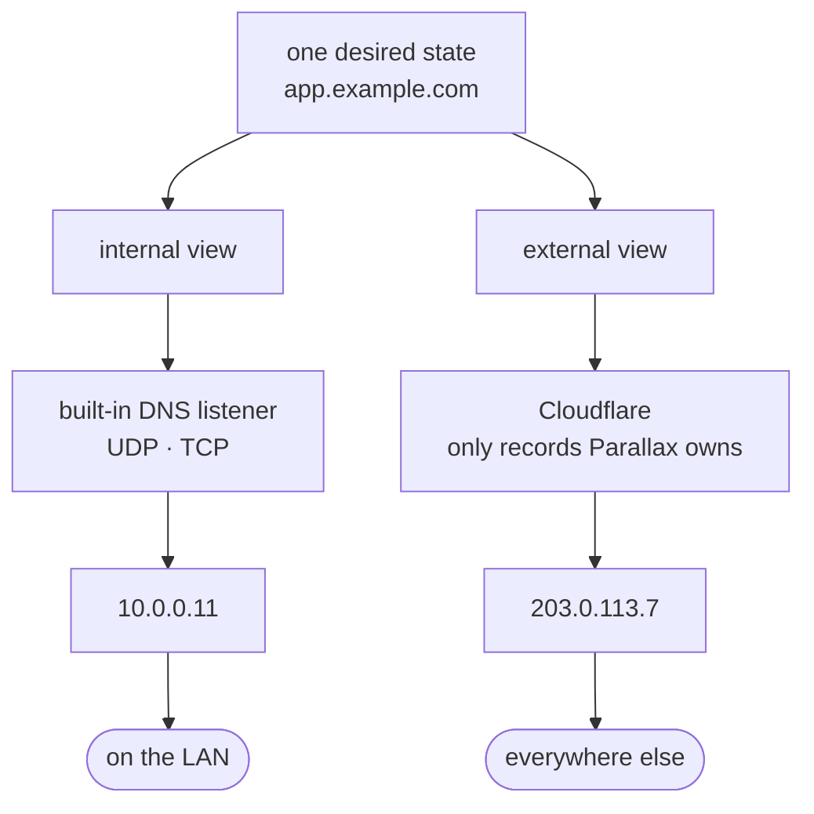
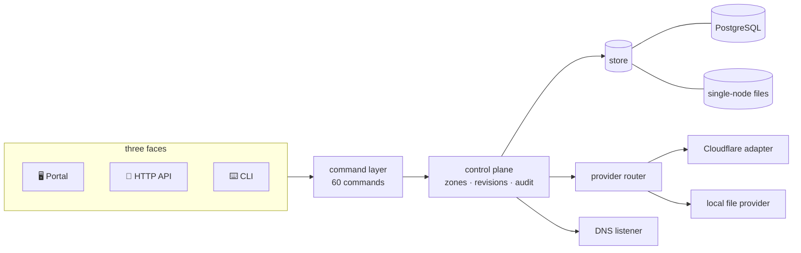
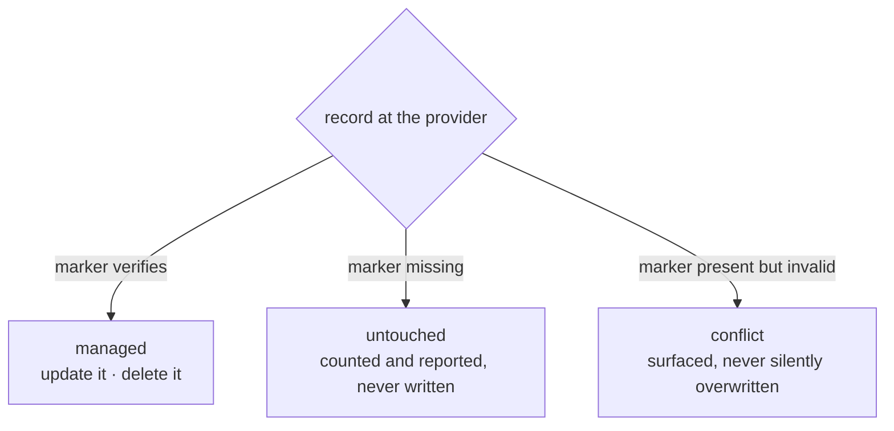

<div align="center">

<h1>parallax</h1>

### **A split-horizon DNS control plane and operations portal.**

One desired state for internal DNS and external provider DNS — previewed before
it moves, and applied only to the records it owns.

<br/>

[](https://github.com/henryj-dev/parallax/actions/workflows/check.yml)
[](https://github.com/henryj-dev/parallax/actions/workflows/codeql.yml)

<br/>


[](#http-api)
[](LICENSE)

<br/>

> *A parallax is the shift in a thing's apparent position when you look at it from
> somewhere else — one object, two answers, both of them correct.*

English · [한국어](README.ko.md)

</div>

---

## Contents

- [The problem](#the-problem)
- [What it does](#what-it-does)
- [Quick start](#quick-start)
- [How it fits together](#how-it-fits-together)
- [The ownership model](#the-ownership-model)
- [Configuration](#configuration)
- [Command line](#command-line)
- [HTTP API](#http-api)
- [Record types](#record-types)
- [The portal](#the-portal)
- [Operations](#operations)
- [Development](#development)
- [Status & limitations](#status--limitations)
- [License](#license)

---

## The problem

The same name has to mean two different things depending on who is asking.
Keeping that in two systems means keeping it right twice.



Parallax holds **one** desired state, projects it into **two** views, and
reconciles each view with whatever is actually there — after showing you the
plan.

---

## What it does

<table>
<tr>
<td width="50%" valign="top">

### 🎯 One state, two views
Every record lives once. `internal` and `external` are projections of it, and
every provider target is addressed as `<zone>/<view>`.

</td>
<td width="50%" valign="top">

### 🛡️ Touches only what it owns
Each published record carries an **HMAC-signed ownership marker**. Records it
did not write are counted, reported, and left alone.

</td>
</tr>
<tr>
<td valign="top">

### 👁️ Preview before apply
`preview` builds a plan — creates, updates, deletes, conflicts — and an
explicit count of the records it will **not** touch, so "nothing to do" can
never be mistaken for "there is nothing there".

</td>
<td valign="top">

### 📡 Answers DNS itself
An authoritative listener for the internal view over UDP and TCP: EDNS(0), DNS
cookies, AXFR (denied by default), outbound NOTIFY, allow-listed forwarding,
per-client rate limiting, and opt-in health checks that leave failing
addresses out of an internal A or AAAA answer.

</td>
</tr>
<tr>
<td valign="top">

### ⏪ Every change is a revision
Numbered revisions, snapshot restore, and a ten-action audit trail that reports
how many records each revision added, removed and changed.

</td>
<td valign="top">

### 🤝 Adopt without seizing
`zone adopt` *describes* what already exists at the provider. Taking records
over is a separate, explicit decision.

</td>
</tr>
<tr>
<td valign="top">

### 🔐 Roles, tokens, and SSO
`viewer` · `editor` · `admin`. Issued access tokens, or OpenID Connect sign-in
written directly against the protocol.

</td>
<td valign="top">

### 🧭 Same brain, three faces
The portal, the HTTP API and the CLI all invoke **the same command layer** — so
they cannot drift apart.

</td>
</tr>
</table>

---

## Quick start

```bash
git clone https://github.com/henryj-dev/parallax
cd parallax
corepack enable
pnpm install --frozen-lockfile
```

**Run it.** With nothing configured it binds loopback and keeps state in files —
no database, no token, no ceremony:

```bash
pnpm dev                       # http://127.0.0.1:3000
```

**Or drive it from the command line.** The CLI reaches the store directly. A
record's body arrives as one JSON value, the same shape the HTTP API takes:

```bash
pnpm cli settings set --values '{"allowLocalProvider":true}'   # publish to a file, for now

pnpm cli zone create --zone example.com
pnpm cli record set --zone example.com --view internal --id app \
        --record '{"name":"app","type":"A","content":"10.0.0.11","ttl":300}'
pnpm cli record set --zone example.com --view external --id app \
        --record '{"name":"app","type":"A","content":"203.0.113.7","ttl":300,"acknowledgeNonGlobalIp":true}'

pnpm cli preview --zone example.com     # what would change
pnpm cli apply   --zone example.com     # make it so
pnpm cli status  --zone example.com     # how far each view got
```

Two of those lines are the guards working rather than getting in the way.
`allowLocalProvider` is off by default, so without it `apply` reports each view
as `failed` with `no provider is configured` — there is nothing to publish to
until a Cloudflare credential exists, and a file stands in meanwhile.
`203.0.113.7` is a documentation address, which is not globally routable, so the
external view refuses it until somebody says the exposure was reviewed. Both
refusals are the point; a real deployment reaches a real provider with a real
address and needs neither line.

> [!IMPORTANT]
> Parallax **refuses to start on a non-loopback address with no access token**.
> Issue one from a loopback session, or set `PARALLAX_AUTH_TOKENS`. That is a
> startup check, not a warning.

---

## How it fits together



The command layer is the only way in. The HTTP API is a thin mapping onto it —
each operation in the OpenAPI document names the command it reaches — and the
CLI acts with full rights because a shell on the box *is* control-plane access.

<details>
<summary><b>The source tree</b></summary>

| Directory | What lives there |
|---|---|
| `src/domain/` | Record types, validation, the reconciliation planner, zone files |
| `src/application/` | Control plane, settings, access tokens, credentials, fallback domains |
| `src/adapters/` | Cloudflare, the ownership marker, the provider router |
| `src/dns/` | Wire format, RDATA, cookies, the authoritative listener, snapshots |
| `src/http/` | API, identity routes, OpenAPI generation, readiness, portal assets |
| `src/infrastructure/` | PostgreSQL, file state, atomic writes, migrations |
| `src/security/` | Authorization, OIDC, session tokens, encrypted credential store |
| `src/observability/` | Prometheus metrics and signals |
| `public/` | The portal — vanilla JS, no bundler |
| `cmd/parallax/` | The command-line entry point |

</details>

---

## The ownership model

This is the part that lets Parallax share a zone with a human, a Terraform run,
and a certificate bot without any of them stepping on the others.

Every record Parallax publishes carries a marker in the provider's free-text
field — a Cloudflare record comment, a trailing comment in a zone file:

```text
parallax-managed:v3:<record-id>:<hmac-signature>
```



The signature covers the **target** as well as the record id, so a marker copied
to another zone stops verifying there. The marker deliberately does *not* carry
the target itself: a Cloudflare comment is capped at 100 characters, and
spending that budget on a value the caller already knows once made every write
against a long zone name fail.

> [!NOTE]
> Rotating `PARALLAX_OWNERSHIP_SECRET` orphans every record already published —
> they stop verifying and become *untouched*.

---

## Configuration

Nothing below is required to start on loopback with file state.

<details open>
<summary><b>Core</b></summary>

| Variable | |
|---|---|
| `HOST` · `PORT` | Where the API and portal bind. Defaults `127.0.0.1:3000` |
| `DATABASE_URL` | Use PostgreSQL. Absent means single-node files |
| `PARALLAX_STATE_FILE` · `PARALLAX_CONFIG_FILE` · `PARALLAX_PROVIDER_STATE_FILE` | Where those files live. The state file keeps its history beside it in `<state file>.d/` — back up the directory, not the one file |
| `PARALLAX_AUTH_TOKENS` | Break-glass tokens, as JSON. Normal tokens are issued through the portal |
| `PARALLAX_AUTH_MODE` | `legacy` (the default when unset) or `accounts`. `accounts` needs its own policy file, key and SMTP settings and refuses to start without them; any other value is a configuration error. See [Member accounts](#member-accounts) |
| `PARALLAX_OWNERSHIP_SECRET` | Signs ownership markers |
| `PARALLAX_CREDENTIAL_MASTER_KEY` | Encrypts stored provider credentials (AES-256-GCM) |

</details>

<details>
<summary><b>TLS &amp; identity</b></summary>

| Variable | |
|---|---|
| `PARALLAX_TLS_CERT_FILE` · `PARALLAX_TLS_KEY_FILE` | End TLS in-process instead of behind a proxy. Reloaded on change |
| `PARALLAX_HTTP_REDIRECT_PORT` | Answer plain HTTP with a redirect to the TLS origin |
| `PARALLAX_OIDC_ISSUER` · `_CLIENT_ID` · `_CLIENT_SECRET` · `_REDIRECT_URI` · `_SCOPES` | OpenID Connect sign-in. The endpoints come from the issuer's `/.well-known/openid-configuration`; a provider that publishes none falls back to `{issuer}/oidc/…` and says so at sign-in |
| `PARALLAX_OIDC_ROLE_CLAIM` | Which userinfo claim grants a role here — `admin`, `editor` or `viewer`. Defaults to `entitlements`; no claim is standard, so a directory that spells it otherwise must say so |
| `PARALLAX_OIDC_SESSION_SECRET` · `_SESSION_SECONDS` | Session signing and lifetime |
| `PARALLAX_PORTAL_SIGN_IN` | What the portal offers a visitor who has not signed in |

</details>

<details>
<summary><b>The DNS listener</b></summary>

Setting `PARALLAX_DNS_PORT` is what turns it on. Everything else has a default,
and the defaults are the careful ones.

| Variable | |
|---|---|
| `PARALLAX_DNS_PORT` | **Enables the listener.** Unset leaves the port unbound |
| `PARALLAX_DNS_HOST` | Defaults to `HOST`, then to `127.0.0.1` |
| `PARALLAX_DNS_FORWARD_TO` | Upstreams for names outside every zone. Empty answers `REFUSED` |
| `PARALLAX_DNS_FORWARD_ALLOW` | Client CIDRs allowed to recurse. Defaults to loopback — and is **required** if the listener is not loopback and forwarding is on |
| `PARALLAX_DNS_FALLBACK_ZONES` | Zones whose empty answers (NXDOMAIN, or NODATA) are asked of the upstream before being given. Off when empty. Never for a name with an internal override, a client outside `FORWARD_ALLOW`, a signed query, or a name under `FALLBACK_EXCLUDE`; an upstream that fails leaves the local answer. The upstream's negative TTL is capped at the local one |
| `PARALLAX_DNS_FALLBACK_EXCLUDE` | Names that, with everything below them, never fall back — subtrees that exist only inside. Each must lie in a fallback zone |
| `PARALLAX_DNS_FORWARD_DENY` | Addresses an upstream may never be or resolve to: the resolvers that forward back here (gateway, cluster DNS, this listener's service address). **Required** with `FALLBACK_ZONES` |
| `PARALLAX_DNS_DRIFT_INTERVAL_MS` | How often to count records the provider publishes that a served zone's internal view does not answer for (`parallax_dns_provider_only_records`, names in the log). Default 900000; `0` is off |
| `PARALLAX_DNS_TRANSFER_ALLOW` | Client CIDRs allowed `AXFR` and `IXFR`. **Defaults to deny all** |
| `PARALLAX_DNS_TSIG_KEYS` | `name:algorithm:base64secret`, comma-separated. Setting any key makes a valid TSIG signature **required** for `AXFR`; `hmac-sha256`/`hmac-sha512` only |
| `PARALLAX_DNS_NOTIFY_TO` | Hosts that get NOTIFY when a served zone's serial rises. `host`, `host:port`, or `host:port#keyname` to sign it |
| `PARALLAX_DNS_INTERNAL_UPDATE` | `host:port#keyname` — also publish the internal view into a server that speaks **RFC 2136**. A server published to keeps answering when this process stops; a listener inside it does not |
| `PARALLAX_DNS_SOA_PRIMARY` · `_SOA_MAILBOX` | SOA fields |
| `PARALLAX_DNS_REQUIRE_COOKIE` | Require RFC 7873 DNS cookies |
| `PARALLAX_DNS_RATE_LIMIT_PER_SECOND` · `_BURST` · `_MAX_CLIENTS` | Per-client rate limiting |
| `PARALLAX_DNS_MAX_TCP_CONNECTIONS` · `_MAX_CONCURRENT_FORWARDS` · `_FORWARD_TIMEOUT_MS` | Resource ceilings |

</details>

<details>
<summary><b>Stored settings</b> — in the store, not the environment</summary>

| Setting | |
|---|---|
| `allowLocalProvider` | Publish to a local file when no real provider is configured |
| `publicOrigin` | Absolute origin browsers reach the portal at; empty derives it per request |
| `trustForwardedHeaders` | Trust `X-Forwarded-Proto` / `X-Forwarded-Host`, and `X-Forwarded-For` as the client address member attempt limits count by |
| `revisionRetention` | Newest snapshots kept per zone; `0` keeps every one |
| `auditRetentionDays` | Days of audit history kept per zone; `0` keeps everything |
| `fallbackResolver` | Address a client-side resolver override should point at |
| `dnsHealthChecksEnabled` | Probe the addresses internal health checks protect. Default `false` |
| `dnsHealthCheckAllowCidrs` | Networks a probe may connect to. Default empty, which allows none |
| `dnsHealthCheckAllowPorts` | Ports a probe may connect to. Default empty, which allows none |

</details>

---

## Command line

60 commands. Add `--json` to any of them for machine-readable output; run
`parallax help <command>` for its options.

<details open>
<summary><b>Zones &amp; records</b></summary>

| Command | |
|---|---|
| `zone list` · `zone get` · `zone create` · `zone delete` | The basics |
| `zone replace` | Replace a zone's complete desired state |
| `zone adopt` | Describe what already exists at the provider, without taking it over |
| `zone export` · `zone import` | Presentation-format zone files, per view |
| `record list` · `get` · `set` · `create` · `patch` · `delete` | One record at a time |
| `record batch` | Deletes, patches, puts and posts as a **single revision** |

</details>

<details>
<summary><b>Reconciliation</b></summary>

| Command | |
|---|---|
| `preview` | Compare desired and actual state, change nothing |
| `apply` | Reconcile one zone's providers |
| `apply pending` | Apply every pending zone; `--retryFailed` to retry failures |
| `status` | How far each view has been applied |

</details>

<details>
<summary><b>History</b></summary>

| Command | |
|---|---|
| `history` | The audit trail, newest first |
| `revision list` · `revision get` | Stored snapshots |
| `revision restore` | Restore a snapshot as a **new** revision |

</details>

<details>
<summary><b>Credentials &amp; access</b></summary>

| Command | |
|---|---|
| `credential profile list` · `get` · `set` · `delete` · `test` | Reusable account credentials |
| `credential zone list` · `get` · `set` · `delete` · `test` | Bind an apex domain to a profile and zone id |
| `token list` · `token issue` · `token revoke` | Access tokens — issued tokens are returned exactly once |
| `settings get` · `settings set` | Stored operational settings |

</details>

<details>
<summary><b>Client-side resolver overrides</b></summary>

Cloudflare's local-domain fallback list, driven by the credential the profile
already holds — nobody types a second token.

| Command | |
|---|---|
| `fallback list` | Show the overrides |
| `fallback coverage` | For every zone held here: is it covered, and why not |
| `fallback preview` · `fallback sync` | Show, then make, the overrides match this profile's zones |
| `fallback set` · `fallback delete` | One suffix at a time |

</details>

<details>
<summary><b>Internal health checks</b></summary>

| Command | |
|---|---|
| `health check list` | The policies on a zone's internal view |
| `health check set` · `health check delete` | One policy per internal A or AAAA RRset, each a new revision |
| `health check status` | Each policy and **this process's** verdict on each address |

```bash
pnpm cli health check set --zone example.com \
  --policy '{"name":"app","type":"A","enabled":true,"probe":{"kind":"tcp","port":443}}'
pnpm cli health check set --zone example.com --whenNoneHealthy answer-all \
  --policy '{"name":"app","type":"A","enabled":true,"probe":{"kind":"https","port":8443,"path":"/readyz"}}'
pnpm cli health check status --zone example.com
```

</details>

<details>
<summary><b>Operations</b></summary>

| Command | |
|---|---|
| `config check` | Report what would stop this process from starting — **without starting it** |
| `migrate` | Apply the database schema; safe to re-run |
| `backup` | Write everything this store holds as one document |
| `restore` | Load such a document into an **empty** store, from either backend |
| `openapi` | Print this control plane's own OpenAPI description |

</details>

<details>
<summary><b>Member accounts (host only)</b></summary>

| Command | |
|---|---|
| `accounts enable` · `accounts status` · `accounts list` | Turn member accounts on, and look at them |
| `accounts bootstrap` | The first administrator, password from stdin |
| `accounts recover` · `accounts mfa reset` | Replace a lost second factor |
| `accounts legacy` | A fixed window for existing provider sign-ins |

None of these is reachable over HTTP. See [Member accounts](#member-accounts).

</details>

`backup` and `restore` have no HTTP route and cannot get one: the serving
runtime is not given the repositories they use, so neither the credential
document nor a direct write to the revision history is reachable through a
port. They are also how you move between backends — the two stores implement
the same interfaces, and the document only ever speaks to those:

```bash
PARALLAX_STATE_FILE=./data/state.json parallax backup --json > parallax-backup.json
DATABASE_URL=postgres://… parallax migrate
DATABASE_URL=postgres://… parallax restore < parallax-backup.json
```

> [!WARNING]
> The document is **as sensitive as the state file**, because it is a copy of
> it: it carries the credential store's ciphertext, which is useless without
> `PARALLAX_CREDENTIAL_MASTER_KEY` and is still not something to leave where the
> state file would not be left. `restore` refuses a store that already holds
> zones or tokens — it is not a merge. Audit ids are assigned by the store, so a
> restored log is renumbered from 1; the order and the content survive.

---

## HTTP API

**67 paths**, described by an OpenAPI 3.1 document the process generates from
its own command table — so the description cannot drift from the behaviour.

```http
GET /api/v1/openapi.json
```

<details>
<summary><b>Every route</b></summary>

| | |
|---|---|
| **Zones** | `GET POST /zones` · `GET PUT DELETE /zones/{zone}` |
| **Records** | `GET /zones/{zone}/records`<br/>`GET POST /zones/{zone}/views/{view}/records`<br/>`GET PUT PATCH DELETE …/records/{id}`<br/>`POST …/records/batch` |
| **Reconcile** | `GET POST /zones/{zone}/preview` · `POST /zones/{zone}/apply` · `POST /apply` · `POST /zones/{zone}/adopt` |
| **State** | `GET /status` · `GET /zones/{zone}/status` · `GET /zones/{zone}/export` · `POST /zones/{zone}/import` |
| **History** | `GET /history` · `GET /zones/{zone}/history` · `GET /zones/{zone}/audit`<br/>`GET /zones/{zone}/revisions` · `GET …/revisions/{revision}` · `POST …/restore` |
| **Admin** | `GET PUT /settings` · `GET POST /tokens` · `DELETE /tokens/{id}` |
| **Credentials** | `GET /credentials/profiles` · `GET PUT DELETE /credentials/profiles/{name}` · `POST …/test`<br/>`GET /credentials/cloudflare` · `GET PUT DELETE /credentials/cloudflare/{zone}` · `POST …/test` |
| **Fallback** | `GET /fallback/{profile}` · `…/coverage` · `…/preview` · `POST …/sync` · `PUT DELETE …/domains/{suffix}` |
| **Health checks** | `GET /zones/{zone}/views/internal/health-checks` · `PUT DELETE …/health-checks/{name}/{type}`<br/>`GET /zones/{zone}/health-check-status` |
| **Meta** | `POST /cli` · `GET /openapi.json` · `POST DELETE /session` |
| **Probes** | `GET /health/live` · `GET /health/ready` · `GET /metrics` |

</details>

**Roles.** `viewer` reads. `editor` changes records. `admin` gets everything —
and credentials, settings and tokens are admin-only **including reads**, because
each one exposes or changes who can act.

**Optimistic concurrency.** Mutating operations accept an `expectedRevision` and
refuse if the zone moved on.

---

## Record types

23 types, validated by their RDATA in presentation format — the same text a zone
file puts after the type:

```text
A · AAAA · CAA · CERT · CNAME · DNAME · DNSKEY · DS · HINFO · HTTPS · LOC · MX
NAPTR · NS · OPENPGPKEY · PTR · SMIMEA · SRV · SSHFP · SVCB · TLSA · TXT · URI
```

`SOA` is excluded, and so are the DNSSEC records a signer produces for the zone
it signs — `RRSIG`, `NSEC`, `NSEC3`. Every provider generates those itself, and
publishing our own would overwrite an answer we never asked for. `DS` and
`DNSKEY` *are* here: a `DS` sits in the parent and delegates to a signed child,
which is an operator's decision about somebody else's zone.

> [!WARNING]
> Publishing a non-global address in the **external** view requires setting
> `acknowledgeNonGlobalIp` on that record. It is refused otherwise — putting
> `10.0.0.11` on the public internet is usually a mistake, and when it isn't, it
> should be one somebody made on purpose.

---

## The portal

Served from the same process, in **English and Korean**, with no build step.

- **Horizon lens** — one record, both answers, side by side
- **Zone workspace** — records, sync state per view, revision progress
- **Apply plan dialog** — review the plan, then apply from it
- **Revision history** — browse snapshots and restore one
- **Credential settings** — profiles, zone bindings, resolver overrides, tokens
- **Sign-in** — access token or your identity provider

---

## Operations

### Observability

| Endpoint | |
|---|---|
| `GET /health/live` | The process is up |
| `GET /health/ready` | It would answer correctly — fails closed on stale desired state |
| `GET /metrics` | Prometheus text format |

Gauges are read at scrape time from whoever already owns the value, rather than
copied into a registry where the copy can go stale.

```text
parallax_ready                                  1 when this process would pass readiness
parallax_desired_state_age_seconds              since the desired state was last read
parallax_desired_state_max_age_seconds          how stale that may get before readiness fails
parallax_dns_served_zones                       zones the listener answers for
parallax_dns_health_healthy_targets             protected addresses this process gives out
parallax_dns_health_unhealthy_targets           protected addresses held back because probes fail
parallax_dns_health_unknown_targets             protected addresses with no fresh result
parallax_access_token_cache_ready               tokens fresh enough to authenticate with
parallax_access_token_cache_age_seconds         since that cache last refreshed
parallax_dns_zones_skipped_total                zones whose internal view would not compose
parallax_dns_unservable_records_total           stored records that reached the wire and could not
parallax_dns_unanswerable_replies_total         queries that could not be answered
parallax_dns_notify_failures_total              NOTIFY sends that failed
parallax_dns_health_probes_total                health probes, by result
parallax_dns_health_transitions_total           health state changes, by the state entered
parallax_dns_health_servfail_total              protected answers refused because no address qualified
parallax_dns_health_fail_open_total             protected RRsets answered in full under answer-all, none healthy
parallax_dns_forward_failures_total             DNS forwarding failures by upstream index and reason
parallax_refresh_failures_total                 background refresh failures, by subsystem
parallax_postgres_connection_errors_total       pooled connections that failed, by state (idle, checked_out) and code
parallax_tls_certificate_reload_failures_total  certificate reloads that failed
```

### Internal health checks

A policy protects one A or AAAA RRset in a zone's **internal** view. The
internal listener then answers it with only the addresses whose probes pass.
The external view, every provider, `preview` and `apply` are unaffected:
nothing about health is published anywhere.

- **Off until two things are set.** `dnsHealthChecksEnabled` turns probing on,
  and an address is probed only when it falls inside
  `dnsHealthCheckAllowCidrs` and its port is in `dnsHealthCheckAllowPorts`.
  Loopback, link-local, multicast, translated (IPv4-compatible, SIIT, NAT64,
  Teredo, 6to4), known cloud metadata addresses and other reserved ranges are
  refused whatever the list says. A probe connects to the address itself;
  nothing is resolved.
- **It fails closed.** An enabled policy whose RRset has no healthy address —
  probing off, an address outside the allow-list, or no fresh success — is
  answered `SERVFAIL`, not with every address. Only `enabled: true` turns a
  policy on; a policy that leaves `enabled` out, or sets it to `false`, is kept
  and the RRset is answered in full.
- **Or, per policy, it answers every address.** `whenNoneHealthy` is
  `servfail` by default. Set to `answer-all`, an RRset with no healthy address
  is answered with all of its addresses at the policy's TTL, and the answer is
  counted in `parallax_dns_health_fail_open_total` rather than
  `parallax_dns_health_servfail_total`; `health check status` reports it as
  `all`. The trade-off: a broken path from this process to the origins no
  longer takes the whole name away, but an address that really is down is
  handed out with the rest. It fails open only when every address is being
  probed and simply has no fresh success — failing, stale, or not yet probed
  after a start. A policy with an issue, probing turned off, an address
  outside the allow-list or past the process limit is configuration nobody is
  observing, and still answers `SERVFAIL`. As soon as one address is healthy
  the answer is filtered as usual. A stored policy carries the field only when
  it is `answer-all`, so existing policies, revisions and backups are unchanged;
  an older release refuses a policy that carries it, so upgrade every replica
  before turning it on.
- **Timing.** Every 10 seconds with jitter, a 2-second deadline per probe, and a
  result is stale after 30 seconds. An address never seen failing is healthy on
  its first success; one seen failing needs two successes in a row. A healthy
  address becomes unhealthy on its third failure in a row. At most 16 probes run
  at once.
- **TTL.** A filtered answer carries `responseTtlSeconds` (5–60, default 30),
  lowered further to the smallest TTL in the RRset.
- **Limits.** 64 policies per zone, and 64 probed addresses per process. An
  address past that limit is reported `over_limit` and is not given out.
- **Transfers stop.** While a zone has an enabled policy, AXFR and IXFR are
  refused and secondaries are not sent NOTIFY, because a secondary would serve
  every address. A secondary keeps the copy it already holds.
- **HTTPS probes** verify the certificate against the RRset's name. A private
  CA reaches Node through `NODE_EXTRA_CA_CERTS`.
- **Status is process-local.** Each replica probes from where it sits and keeps
  nothing in the store, so behind a load balancer two requests can see two
  verdicts.

Policies live in the internal view of the desired state, so a revision, a
restore, `backup` and `restore` carry them; none of this adds a table or a
migration. A full `PUT /zones/{zone}` that leaves `healthChecks` out while the
stored view carries policies is refused with `409`, so a writer that predates
health checks cannot drop them silently. Do not run such a writer against a
store that holds policies: rolling back past this release means deleting the
policies first.

### Deployment

```bash
docker build -t parallax .
docker run --rm -p 3000:3000 \
  -e HOST=0.0.0.0 \
  -e PARALLAX_AUTH_TOKENS='[…]' \
  parallax
```

The image runs the API, the portal and the CLI from one process, as an
unprivileged uid `10001`. `migrations/` stays root-owned and unwritable by that
uid on purpose: compromising the service must not let it plant SQL for a later
privileged `parallax migrate`.

### Security assumptions at deployment

The DNS `servedByProvider` path intentionally relays provider-placeholder names
even when the client is outside `forwardAllow`. It is not a general open
resolver: the name must belong to a served zone and use that zone's configured
placeholder. Both UDP and TCP entry points still apply the per-client rate
limiter, and `maxConcurrentForwards` (default `256`) bounds in-flight work.
However, if `forwardTo` points at an internal resolver, this path gives external
clients a limited view of internal DNS answers. Treat internal-name exposure
and SSRF-like reachability as part of the deployment threat model, and keep the
placeholder set limited to names that are safe to relay.

Authorization is route-based, not zone-based. An `editor` may edit, apply,
import, or restore every zone visible to this deployment; there is no per-zone
RBAC. Multi-team deployments must isolate zones into separate control planes or
add an explicit zone authorization layer before treating an editor as
tenant-scoped.

The cookies have different security meanings: `parallax_identity` (prefixed
`__Host-` over HTTPS) is an HMAC-signed identity session, `parallax_session`
is the token session, and `parallax_oidc_id` is a sensitive provider ID token
used only for IdP logout, not an API bearer credential. HTTPS deployments use
the `__Host-` names and do not accept the old unprefixed names; existing
browsers therefore need one sign-out during rollout.

Set `PARALLAX_SESSION_SECRET` to a stable random value of at least 32 bytes on
every replica. It signs the browser session exchanged from an access token;
without it, the server refuses to issue a token session rather than placing the
bearer token in a cookie. Rotating it logs out all token sessions.

Failed HTTP authentication attempts are counted in a bounded, process-local
LRU map after credential verification. This is not a guessing throttle: every
credential is still evaluated, and a multi-replica deployment will see failure
observations separately. A shared limiter is an observability improvement, not
a substitute for the 32-byte minimum token entropy.

| Store | When |
|---|---|
| **PostgreSQL** | `DATABASE_URL` is set. Ten tables, applied by `parallax migrate` |
| **Files** | Otherwise. Atomic writes, `0600` files inside a `0700` directory |

### Member accounts

People can sign in with an account of their own — an email address, a password
and an authenticator app — and may link an organization (OpenID Connect)
account to it. It is off until a host operator turns it on, and machines keep
their bearer tokens throughout.

**Turning it on.** Every step is explicit; nothing turns on by itself.

1. `parallax migrate`. Migration 006 adds three tables and turns nothing on.
2. Write the policy file and set the variables below. **No number has a
   default.** A missing, unknown or out-of-range field stops startup and
   `parallax config check` alike.
3. Stop every replica of an older version (see *Rolling back* below).
4. Start with `PARALLAX_AUTH_MODE=accounts`, then on the host:

   ```bash
   parallax accounts enable
   parallax accounts bootstrap --email admin@example.com --display-name Admin < password-file
   ```

   The password is read from stdin and never from the command line, and the
   command prints no sign-in secret. That administrator then signs in at
   `/account/login` with the password, enrolls an authenticator and saves the
   recovery codes; until then every member session is refused.

| Variable | |
|---|---|
| `PARALLAX_ACCOUNT_POLICY_FILE` | The JSON policy below. Required |
| `PARALLAX_ACCOUNT_KEY` | 32 random bytes, base64url. Separate keys for authenticator-secret encryption, CSRF tokens and attempt counters are derived from it. Keep it out of backups: without it no stored factor can be read |
| `PARALLAX_ACCOUNT_PUBLIC_ORIGIN` | The `https://` origin mailed links point at. Never taken from a request's `Host` |
| `PARALLAX_SMTP_HOST` · `PARALLAX_SMTP_PORT` · `PARALLAX_SMTP_TLS` | Where mail goes. `PARALLAX_SMTP_TLS` is `implicit` or `starttls` and is never guessed from the port; both verify the server certificate and refuse plain text |
| `PARALLAX_SMTP_NAME` · `PARALLAX_SMTP_FROM` · `PARALLAX_SMTP_USER` · `PARALLAX_SMTP_PASSWORD` | EHLO name, sender address and credentials |
| `PARALLAX_SMTP_CONNECTION_TIMEOUT_MS` · `PARALLAX_SMTP_GREETING_TIMEOUT_MS` · `PARALLAX_SMTP_SOCKET_TIMEOUT_MS` · `PARALLAX_SMTP_DNS_TIMEOUT_MS` | Each one required |
| `PARALLAX_SMTP_MAX_CONNECTIONS` · `PARALLAX_SMTP_MAX_QUEUED` · `PARALLAX_SMTP_MAX_MESSAGES` | Each one required |
| `PARALLAX_ACCOUNT_OIDC_ALGORITHMS` · `PARALLAX_ACCOUNT_OIDC_TIMEOUT_MS` · `PARALLAX_ACCOUNT_OIDC_COOLDOWN_MS` · `PARALLAX_ACCOUNT_OIDC_CACHE_MAX_AGE_MS` · `PARALLAX_ACCOUNT_OIDC_MAX_TOKEN_AGE_SECONDS` · `PARALLAX_ACCOUNT_OIDC_CLOCK_TOLERANCE_SECONDS` | Required when `PARALLAX_OIDC_ISSUER` is set. Algorithms are a comma list of `RS256`, `ES256`, `EdDSA` |

The policy file has exactly these fields. The code carries no value; the
example below fills in the shared account policy agreed so far (test values
are separate and much smaller). The zeros are what is still the operator's to
choose — concurrent and queued hashing, the session touch interval and
per-member session count, the email-change and sign-in code lifetimes, the
provider sign-in limit, the table bound, the audit entry bound and the TOTP
issuer name — and the file is refused until they are set.

```json
{
  "loginKey": "email-nfc-lowercase-v1",
  "password": { "minLength": 8, "maxBytes": 65536, "maxConcurrent": 0, "maxQueued": 0,
    "scrypt": { "N": 65536, "r": 8, "p": 2, "maxmem": 100663296, "keylen": 32 },
    "verifyLimits": { "maxMemoryBytes": 100663296, "maxWork": 1048576, "maxKeylen": 32 } },
  "session": { "idleSeconds": 1800, "absoluteSeconds": 43200, "touchIntervalSeconds": 0, "maxPerUser": 0 },
  "recentAuthSeconds": 600,
  "mfa": { "digits": 6, "periodSeconds": 30, "window": 1, "algorithm": "SHA1", "recoveryCodeCount": 10, "issuer": "" },
  "tokens": { "inviteSeconds": 259200, "resetSeconds": 1800, "emailChangeSeconds": 0, "challengeSeconds": 0, "enrollmentSeconds": 86400 },
  "rateLimit": {
    "login": { "attempts": 5, "windowSeconds": 900, "baseDelaySeconds": 1, "maxDelaySeconds": 900 },
    "mfa": { "attempts": 5, "windowSeconds": 900, "baseDelaySeconds": 1, "maxDelaySeconds": 900 },
    "reset": { "attempts": 5, "windowSeconds": 900, "baseDelaySeconds": 1, "maxDelaySeconds": 900 },
    "link": { "attempts": 0, "windowSeconds": 0, "baseDelaySeconds": 0, "maxDelaySeconds": 0 },
    "maxEntries": 0 },
  "retention": { "auditDays": 365, "auditMaxEntries": 0 }
}
```

The shared values mean: passwords of at least 8 characters using three of
lower-case letters, upper-case letters, digits and anything else (spaces and
other scripts count), judged after Unicode NFC, with no maximum beyond the
64 KiB request body and no breached-password list; scrypt N 65536, r 8, p 2;
sessions idle 30 minutes and absolute 12 hours; a code entered at sign-in
counts as recent for 10 minutes; 6-digit SHA-1 codes every 30 seconds with
one step either side, each step used once; 10 single-use recovery codes;
invitations for 3 days, resets for 30 minutes, an authenticator enrollment the
host starts (bootstrap or recovery) for 24 hours — one that follows a password
step lasts as long as any sign-in step, and its browser cookie only for the
browser session; after 5 failures each further attempt waits 1, 2, 4… seconds up
to 15 minutes, a counter starts over 15 minutes after its last attempt, and
nothing locks for good; audit kept a year. A password that misses the rule is
answered `400 weak-password`, before any hashing. Addresses are
compared after Unicode NFC and lower-casing, and nothing else: `a.b+tag@` and
`ab@` stay two people.

**Sessions.** A 32-byte random cookie, `parallax_account` (`__Host-parallax_account`
over HTTPS), `HttpOnly` and `SameSite=Lax`. Only its digest is stored. Every
request reads the member's current role and status from the shared store, so
signing out, suspending, deleting, changing a role or resetting a password ends
the session on every replica from the next request. A missing or ended session
is `401` on every route, read or write. If the account store cannot be read,
management answers `503`; the DNS listener keeps answering. Every mutation needs
this origin and an `x-parallax-csrf` header; a wrong header is refused and never
retried with a cookie.

**Second factor.** Administrators always enter a code at sign-in. A member has
at most one unfinished sign-in challenge (and one reset, email-change or
enrollment link) at a time: a new one replaces the earlier, which stops
working, so repeating the password step cannot crowd out anyone else. The one
exception is the re-enrollment challenge a recovery code issues: an ordinary
sign-in does not replace it, so it stays usable until the new factor is set up
or it expires. Changing a
password, an email address, sessions, organization links, members, tokens,
credentials or settings, and the CLI route, also need a code entered within
`recentAuthSeconds`, from a confirmed authenticator. Enrolling one from a
signed-in session also needs the current password, so a copied session cookie
cannot attach a factor of its own. A code step is accepted once across all
replicas. A
recovery code works once, ends every session, and leads only to enrolling a new
authenticator. That enrollment must finish within `challengeSeconds`; after
that the next recovery code is needed, and once every code is used the factor
is reset on the host. A lost factor is reset on the host: `parallax accounts mfa reset
--user-id <id>`, or for the last administrator `parallax accounts recover
--user-id <id>`, which closes member sign-in until that administrator enrolls
again. The last active administrator with a password and a confirmed factor
cannot be suspended, deleted, demoted or reset, even by two requests at once.

**Machines.** Bearer tokens keep every DNS route. They cannot reach
`/api/v1/account/*`, and in accounts mode `POST /api/v1/session` refuses to turn
a token into a browser session (`403 human_login_required`). `parallax accounts
…` commands exist on the host command line only; `POST /api/v1/cli` cannot run
them. A machine token is independent of the member who issued it: suspending,
demoting or deleting that member leaves the token working until it is revoked or
expires. Who issued or revoked one is recorded in the account audit trail. Listing
tokens needs an administrator session but no recent code; issuing and revoking
need one.

**Attempt limits.** Two limits, both of which must allow an attempt. Each
member carries its own sign-in, code and reset counters, which nothing else can
push out. Every attempt is counted before any password is hashed; a password or
code that turns out right takes back its own attempt from the member, so a
person is never limited for signing in often, while earlier failures stay
counted. Up to `attempts` there is no wait; after that each attempt waits
`baseDelaySeconds × 2^(n−1)` (n counting past `attempts`), capped at
`maxDelaySeconds`, with one attempt allowed after each wait (`429` with
`Retry-After` while waiting), and a counter starts over `windowSeconds` after
its last attempt. Nothing locks for good. The address limit is different on purpose: it
counts every attempt from that address, successes included, so sign-ins to an
account one controls cannot be mixed in to stretch an address's allowance for
guesses at other accounts.

That makes the per-account limit a lever too: anyone who knows an address can
spend its allowance with wrong passwords and make that person — an
administrator included — wait between attempts, up to `maxDelaySeconds`, for as
long as the guessing goes on. It is the
price of limiting guesses per account rather than per client only. To recover
sooner than the window, first make sure the password is one only that person
knows — change it, or reset it — because until a new factor is enrolled anyone
who knows the password can enroll one; then run
`parallax accounts recover --user-id <id>` for the last administrator or
`parallax accounts mfa reset --user-id <id>` for anyone else. Both clear that
member's counters (and replace the factor). A shorter
`windowSeconds` or a larger `attempts` applies to windows that start after the
change. Because a counter starts over only `windowSeconds` after its last
attempt, one request every `maxDelaySeconds` is enough to keep a member waiting
indefinitely; the answer is the same host recovery, after replacing the
password.

Two of these behaviours are product exceptions, decided as such: the client
limit counts successful attempts too, and when a table is saturated the client
and unknown-address counters fall back to each process, so with N replicas
they can be up to N times looser. A real member's own counter is never in a
process: it is always in the shared store.

An address that belongs to no member gets its own keyed counter with the same
limit and window, so in normal operation when it is limited does not show
whether an account exists. Clients are counted by network address — IPv4 by address, IPv6 by its
/64. Both shared tables hold `maxEntries` per kind; a full one drops its oldest
entry still under the limit, and an entry at its limit stays until its window
ends. When a table is full of entries at their limit, the new counter is kept
by the serving process instead, under the same limit: no client shares
another's allowance, an unknown address is still limited at the same attempt
as a real one, and every check runs before any password is hashed. Those
per-process counters have two costs. Each replica keeps its own, so N replicas
allow up to N times the limit while a table is saturated; and they are bounded
in memory, so under a long enough flood the least recently used are dropped,
which can include a counter at its limit
(`parallax_account_local_limiter_evictions_total`). Alert on
`parallax_account_throttle_saturated_total`, which counts every time a table
was full. `rateLimit.link` limits starting a provider sign-in, separately from
resets.

While a table is saturated, that sameness can be bought. Someone willing to
spend requests can tell a missing address from a real one in three ways: with
N replicas behind a load balancer, a missing address may be allowed up to
N × `attempts` tries before every replica limits it, while a real account stops
at `attempts`; the per-process counters are dropped least recently used first,
so roughly 25,000 other requests (half the 50,000-entry bound) can push out a
missing address's locked counter; and the shared table for missing addresses
drops its oldest entry under the limit, so about `maxEntries` requests can push
one out. Each costs a flood that is visible: alert on
`parallax_account_throttle_saturated_total` and
`parallax_account_local_limiter_evictions_total`.

The client limit counts a network address, not a person, and that is intended:
people behind one NAT, office proxy or VPN exit share one bucket, so one of
them guessing or mistyping can make the others get `429` for a sign-in, a code
or a reset while the wait lasts; their own member counters are unaffected.
Which address that is depends on how requests arrive. Behind a reverse proxy,
turn on the `trustForwardedHeaders` setting only when every request comes
through that proxy and it overwrites `X-Forwarded-For`: off, every client is
counted as the proxy and shares one bucket; on without such a proxy, a client
can name any address it likes. Size `attempts` and `windowSeconds` for the
largest group that shares an address and how often its members sign in — every
sign-in behind a NAT or office proxy, successful or not, counts against that one
address — and watch for `429` bursts from one address before raising them. A client whose address cannot be read shares a single bucket,
counted in `parallax_account_unidentified_clients_total` and reported once on
stderr: check the `trustForwardedHeaders` setting and what the proxy puts in
`X-Forwarded-For`. Counters are never backed up, and a counter of an older or
broken shape is dropped (`parallax_account_throttle_entries_dropped_total`)
rather than refusing the store.

Password hashing takes up to `maxConcurrent` × scrypt `maxmem` at once (queued
work waits and takes none). `parallax config check` prints that figure as
`accountHashing.peakMiB` and warns above 512 MiB; compare it with the memory the
container is given.

**Passwords.** A reset replaces a password a member already has; it never
creates one. A person who has only signed in through the provider — automatic
sign-up or the legacy window — has no password to reset, so the provider stays
the only way in for them.

**Leaving and deletion.** A member can delete their own account with a recent
code and the current password (`POST /api/v1/account/delete`); the last
administrator who can sign in cannot. An administrator can delete a member.
Either way the address, display name, password, factor, sessions, mailed links
and attempt counters go at once; what stays is a tombstone with the member id
and `deleted` status, and the provider identities (issuer and subject) the
member linked, so that provider account cannot quietly become a new member.
The address can be invited again. The account audit trail never holds an
address. Backups taken before a deletion still hold that person's data: keep
backups for 30 days, so a departed person's data is gone from them too within
30 days.

**Organization sign-in.** The ID token's signature, issuer, audience, nonce,
age and the PKCE exchange are verified; discovery is not followed off the
issuer's origin. A provider account is linked only from a signed-in member who
entered a code recently, and only by issuer and subject — never by email.
Roles stay in Parallax and the second factor stays the Parallax authenticator,
so an administrator who signs in through the provider still enters a code here.
A provider role source or provider MFA is refused, not merely discouraged: the
current provider contract cannot show that a role was revoked by the next
request, or that a second factor is fresh. Automatic sign-up on a first
provider sign-in is off unless an administrator names one issuer and the most
people it may admit; it makes viewers, refuses an address already in use, and
restricts by issuer and count only — there is no tenant or group restriction
yet.

**The legacy window.** Existing provider sign-ins can keep working for a fixed
time: `parallax accounts legacy --until 2030-01-01T00:00:00.000Z --role-cap
editor`. The role is read the way legacy mode reads it — from userinfo, whose
subject must match the signed ID token, under `PARALLAX_OIDC_ROLE_CLAIM` (by
default `entitlements`), a string or a list, in any case, highest role wins —
then capped, and read again at each sign-in. No email is needed. A legacy
sign-in is not a member: it is kept under a key derived from issuer and
subject, has no address, password or factor, and cannot obtain one by reset,
enrollment or invitation. Its sessions are stored and revocable, end at the
deadline including those already issued, and can do nothing sensitive. When
the person links the same provider account to their invited account, the legacy
record is folded into it and its sessions end. Cookies signed by the old OpenID
Connect session secret are never accepted in accounts mode.

Differences from legacy mode to check before the switch: nobody signs in as an
administrator through the window (the cap is `viewer` or `editor`); every
administrator needs an invited account with an authenticator first; userinfo
must answer for this client with the role claim; and a session made before the
switch is not carried over.

**Backups.** `backup` now writes format 2: members, password hashes, encrypted
factors, recovery-code hashes, linked identities, policy and the account audit
trail. Sessions, mailed links, sign-in challenges and attempt counters are left
out, so a restore starts everybody signed out. A deployment without member
accounts still writes format 1, and format 1 documents still restore. Every
activation stage restores as taken — enabled with no member yet, the first
administrator still enrolling, an administrator recovery in progress — and
member sign-in stays closed in the last two until that administrator signs in
with the password and enrolls a factor. The account section is parsed strictly and every check runs before
anything is written; it is written last, in one transaction with its
activation marker. Zones, settings and tokens are written before it and are not
one transaction across stores: an interrupted restore leaves accounts not
enabled, so sign-in stays closed, and is retried into an emptied store. A
backup is as personal as the store it came from — it still holds members
deleted since — so keep it no longer than 30 days.

**Storage.** All account state is one row (`parallax_account_state`) or one
section of the configuration file, changed under one lock, plus an append-only
audit table pruned by `retention`. Checking a session only reads it; the row is
rewritten when a session is due its `touchIntervalSeconds` touch and by every
sign-in, attempt count and account change. That keeps every rule in one
transaction, and is meant for tens to hundreds of members rather than
thousands.

**Refusing a store a newer version changed.** Enabling writes
`member-accounts-v1` to `parallax_auth_features` (PostgreSQL) or `authFeatures`
(configuration file, now version 2) in the same transaction as the state. A
version that does not recognize a recorded feature stops before any listener
opens; this one stops in legacy mode once accounts are enabled. A record that
cannot be read stops startup too: "could not check" is not "nothing there".

| Message | Meaning |
|---|---|
| `authentication storage is not compatible with this version: ...` | A newer version turned a feature on. Run that version, or follow the rollback below |
| `authentication storage could not be checked, so this version did not start: ...` | The connection, a permission or the lookup failed. Fix access; do not delete records |
| `member accounts are enabled; PARALLAX_AUTH_MODE=accounts is required` | This store has members; legacy mode would serve it without them |

**Rolling back.** The new tables are additive, which does not make an older
binary safe: one that predates the feature check would ignore the members and
reopen the old sign-in. Roll back only to a version that refuses the marker,
from a verified backup, and never by dropping the tables.

**Not yet.** Security notices (password changed, email changed, factor reset,
recovery code used, factor replaced after a recovery code, provider linked or
unlinked) are sent once and not retried. A session is named in the list by when it began. There are no
passkeys, and a member who only ever signed in through the provider cannot add
a password themselves.

### Does this release change the schema?

A deployment that replaces pods one at a time runs two versions at once for a
few seconds. Whether that is safe comes down to one question, and it has a
one-line answer:

```bash
git diff --name-only <deployed>..<new> -- migrations/ src/infrastructure/migrations.ts
```

Empty output means the release changes no schema and the two versions may
overlap. Anything listed means they may not.

> [!WARNING]
> Those two paths **are** the answer, which is the dangerous part: move a
> `CREATE TABLE` outside them and the command keeps returning nothing — and
> nothing reads as "safe to overlap". It would not break; it would start lying,
> on the one release where it mattered.
>
> So it is enforced rather than trusted. `test/infrastructure/schema-surface.test.ts`
> scans `src/` and `cmd/` for DDL living outside the watched paths, and reads
> those paths **out of the command above** rather than repeating them — a third
> copy of a fact is what this class of failure is made of. It also asserts that
> `README.md` and `README.ko.md` state the same paths, because a stale
> translation is a stale check. CI runs it as its own job, from a bare checkout
> with nothing installed, because that is how a deployment runs it.

---

## Development

```bash
pnpm check          # typecheck
pnpm run check:portal
pnpm build
pnpm test           # node --test
```

Three workflows run in CI. `check` carries eight jobs, one per question, so that
a red result names its own cause instead of being one job that failed for any of
eight reasons:
`verify` (types, build, tests on Node 24 and 26), `deployment-gate` (schema
surface, from a bare checkout), `docker` (the image builds and stays
unprivileged), `shellcheck`, `policy` (a
shared reusable workflow: dependency review, secret scan, workflow audit),
`audit` (the installed tree against published advisories — which dependency
review, being about a diff, cannot answer), and `flake-watch` (the suite three
times over, on the weekly schedule only — an intermittent failure is the kind of
verdict that changes while the code does not). One `gate` job collects them:
listing jobs one by one in the ruleset would mean that the day a name changes,
that required check becomes one that does not exist and the protection quietly
disappears.

The branch ruleset requires **two** check names, `gate` and `codeql`.
`codeql` and `scorecard` are separate workflows because their verdicts change
when the code does not — query packs update, repository settings drift — and of
those two only `codeql` is required. `scorecard` is a scoreboard on purpose: a
scoreboard that blocks a merge stops being read and starts being worked around.

A skipped job is not a passing job. `gate` counts only `success` as a pass and
names the one job allowed to skip — `flake-watch`, which runs on the schedule
only — so an `if:` added to any other job turns the gate red instead of turning
it quiet.

The `verify:*` scripts drive real infrastructure and are **not** run in CI:

```bash
pnpm verify:postgres    pnpm verify:dns
pnpm verify:proxy       pnpm verify:cloudflare   # ⚠️ writes to a real zone
```

See [CONTRIBUTING.md](CONTRIBUTING.md) before opening a pull request, and
[SECURITY.md](.github/SECURITY.md) before reporting a vulnerability — privately,
never as an issue.

---

## Status & limitations

**What works.** One desired state projected into an internal and an external view;
HMAC-signed ownership markers; `preview` and `apply` with an explicit count of the
records left untouched; an authoritative DNS listener over UDP and TCP; numbered
revisions with snapshot restore and an audit trail; `zone adopt`; roles, issued
access tokens and OpenID Connect sign-in; a portal, an HTTP API and a CLI over one
command layer; PostgreSQL or single-node file state; a container image that runs
unprivileged.

**What doesn't yet.** Authorization is route-based, not zone-based — an `editor`
may act on every zone this deployment can see, so multi-team use needs separate
control planes until a per-zone layer exists. The **external** view has one real
provider adapter, Cloudflare; the **internal** view is either published into a
server that speaks RFC 2136 (`PARALLAX_DNS_INTERNAL_UPDATE`) or answered by this
process's own listener, and the local file provider stands in for deployments with
no provider configured at all. `restore` is not a merge and refuses a store that
already holds zones or tokens. Member accounts keep roles and the second factor
local: a provider role source or provider MFA is refused, and automatic sign-up
is limited by issuer and count only ([details](#member-accounts)).

---

## License

Apache-2.0. See [LICENSE](LICENSE).
